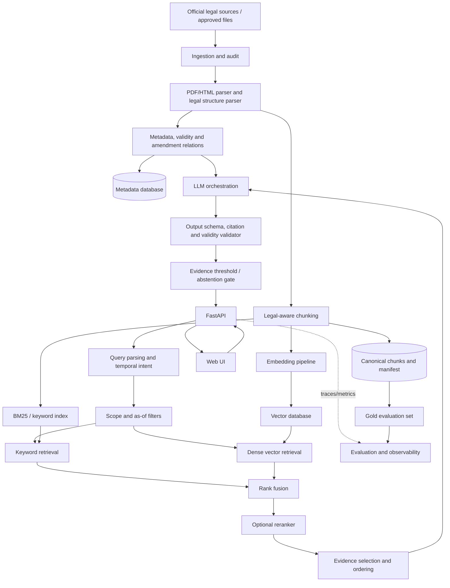
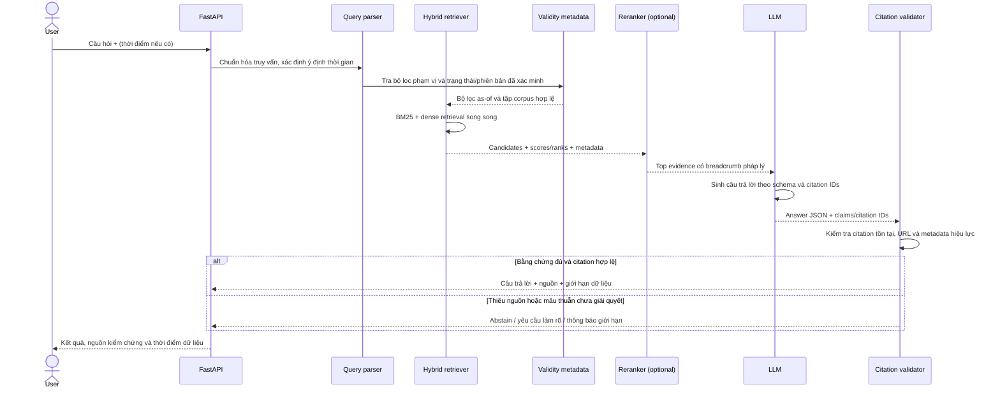
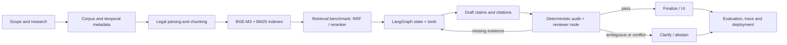

# PROJECT_ROADMAP.md

> **Dự án:** Vietnamese Legal Question Answering System with Retrieval-Augmented Generation (RAG)  
> **Phiên bản roadmap:** 2.0 — Agentic RAG + BGE-M3  
> **Ngày lập:** 21-10-2026  
> **Định hướng:** Project học thuật có MVP chạy end-to-end, đo lường được và có thể mở rộng sang triển khai thực tế.

## Quy ước về độ tin cậy của thông tin

- **[Nguồn]**: nội dung lấy từ paper, tài liệu môn học hoặc nguồn chính thức được dẫn liên kết.
- **[Đề xuất]**: phương án kiến trúc hoặc kế hoạch do roadmap đề xuất; cần được kiểm chứng bằng thực nghiệm.
- **[Giả định]**: giả định lập kế hoạch vì chưa có yêu cầu hoặc tài nguyên cụ thể.
- **[Chưa xác minh]**: thông tin cần kiểm tra trên từng văn bản hoặc với người có chuyên môn trước khi dùng trong hệ thống.

Tài liệu này là lộ trình kỹ thuật, không phải tư vấn pháp lý. Sản phẩm hỗ trợ tra cứu và giải thích nguồn luật; không thay thế luật sư, cơ quan có thẩm quyền hoặc việc tự kiểm tra văn bản gốc.

### Tài liệu đầu vào đã cung cấp

1. **Đề cương môn học về LLM/AI Engineering**: dùng phần kế hoạch giảng dạy chi tiết 15 tuần, chuẩn đầu ra và đánh giá để xây dựng bảng ánh xạ ở Mục 8. Tệp có tên `Đề cương môn học DSIT201.pdf`; tuy nhiên, tiêu đề trang và phần đầu tài liệu có chỗ ghi DSIT201, trong khi header một số trang/mã môn học ghi DSIT301. Roadmap giữ nguyên nội dung 15 tuần từ tệp, không tự suy đoán nguyên nhân khác biệt về mã môn học.
2. **Vietnamese Legal Information Retrieval in Question-Answering System** (arXiv:2409.13699v1): xem như một báo cáo/preprint về bài toán truy xuất pháp luật tiếng Việt, không coi các số liệu được báo cáo là kết quả đã tái lập trong project này. Bài mô tả xử lý dữ liệu tiếng Việt, BM25 + dense retrieval, hợp nhất/xếp hạng kết quả và Active Retrieval.

---

## 1. Tóm tắt điều hành và phạm vi MVP

### 1.1 Mục tiêu sản phẩm

Xây dựng ứng dụng cho phép người dùng đặt câu hỏi pháp luật bằng tiếng Việt tự nhiên. Hệ thống cần:

1. Tìm được điều/khoản/điểm hoặc đoạn văn bản có liên quan từ kho pháp luật đã nạp.
2. Xác định phiên bản và trạng thái hiệu lực phù hợp với thời điểm người dùng hỏi, trong giới hạn metadata đã được kiểm chứng.
3. Sinh câu trả lời ngắn gọn dựa trên bằng chứng truy xuất được.
4. Gắn trích dẫn ở cấp văn bản và điều khoản; mở được nguồn gốc để người dùng kiểm tra.
5. Nói rõ khi dữ liệu không đủ, văn bản có tình trạng chưa xác định hoặc câu hỏi cần làm rõ; không tự bịa căn cứ pháp lý.
6. Có pipeline thực nghiệm để so sánh các cấu hình retrieval/generation và ghi nhận lỗi.

### 1.2 Phạm vi MVP được đề xuất

**[Đề xuất]** Không bắt đầu bằng mục tiêu thu thập toàn bộ pháp luật Việt Nam. Chọn **một lĩnh vực hẹp** trước (hoặc hai lĩnh vực có dữ liệu chính thức đầy đủ và quan hệ văn bản quản lý được), sau đó mở rộng khi đã đánh giá tốt. Lĩnh vực khởi đầu phải được quyết định sau khi kiểm tra chất lượng, quyền truy cập và mức độ đầy đủ của nguồn dữ liệu.

MVP nên có:

- Một bộ dữ liệu pháp luật tiếng Việt với nguồn URL, số hiệu, cơ quan ban hành, ngày ban hành, ngày hiệu lực, trạng thái hiệu lực và thông tin sửa đổi/thay thế khi xác minh được.
- Bộ câu hỏi đánh giá có đáp án chuẩn và đoạn bằng chứng chuẩn.
- Một baseline BM25, một baseline dense retrieval và một cấu hình hybrid.
- Một LLM API hoặc mô hình local cho bước sinh câu trả lời; giao diện gọi model được trừu tượng hóa để đổi nhà cung cấp.
- Câu trả lời có citation IDs trỏ tới đoạn nguồn thật, không để LLM tự sáng tác số hiệu/điều luật.
- Cơ chế từ chối trả lời khi không có bằng chứng đủ mạnh.
- Backend API, giao diện hỏi đáp đơn giản, logging/trace, test và README tái lập được.

### 1.3 Phạm vi MVP và những gì chưa làm

MVP không đồng nghĩa với một chuỗi RAG tuyến tính. Định hướng là **Agentic RAG có kiểm soát**: LangGraph quản lý state machine, các node có thể là hàm Python xác định hoặc LLM/tool call; các quyết định pháp lý quan trọng vẫn phải được kiểm tra bằng logic và metadata có thể audit.

MVP sẽ có: (1) BGE-M3 làm encoder dense mặc định; (2) BM25 + Reciprocal Rank Fusion (RRF); (3) cross-encoder reranker trong cấu hình nâng cao; (4) LangGraph workflow có query planner, tool tra cứu, temporal validity check, evidence/citation audit, bounded retry và abstention; (5) một reviewer/verification role tách biệt về nhiệm vụ.

Chưa đưa vào MVP: bao phủ toàn bộ pháp luật Việt Nam; crawler tự động quy mô lớn; fine-tune model từ đầu; agent có quyền hành động bên ngoài không liên quan; hoặc nhiều agent cùng sinh câu trả lời độc lập mà không có tiêu chí đánh giá. Multi-Agent chỉ được giữ khi có vai trò riêng, tool giới hạn quyền, trace, ngân sách vòng lặp và thực nghiệm so sánh với single-agent workflow.

### 1.4 Câu hỏi nghiên cứu phù hợp với project học thuật

1. Với tài liệu pháp luật tiếng Việt, hybrid search có cải thiện Recall@k/MRR/nDCG so với BM25-only và dense-only không?
2. Chia đoạn theo cấu trúc pháp lý (Điều/Khoản/Điểm) có tốt hơn fixed-size chunking về khả năng truy xuất và độ chính xác citation không?
3. Reranking có cải thiện thứ hạng đoạn bằng chứng đủ để bù cho độ trễ và chi phí thêm vào không?
4. Lọc theo thời điểm hiệu lực và quan hệ sửa đổi/thay thế có làm giảm câu trả lời dựa trên văn bản không còn phù hợp không?
5. Cách tạo câu trả lời có citation bắt buộc và abstention có giảm phát biểu không được nguồn hỗ trợ không?

---

## 2. Nghiên cứu kỹ thuật cốt lõi

### 2.1 Các bài toán kỹ thuật cần giải quyết

| Bài toán | Thách thức trong legal QA | Cách tiếp cận dự kiến |
|---|---|---|
| Thu thập và chuẩn hóa corpus | PDF/HTML không đồng nhất; có bản hợp nhất, sửa đổi và văn bản thay thế; thiếu metadata hoặc scan | Bắt đầu từ corpus hẹp; lưu URL và checksum; kiểm tra text extraction; review metadata và quan hệ văn bản |
| Legal-aware chunking | Cắt ngang Điều/Khoản làm mất ngoại lệ, điều kiện hoặc chủ thể của quy phạm | Ưu tiên Điều/Khoản/Điểm; chỉ dùng chunk theo token khi một đơn vị quá dài; lưu breadcrumb pháp lý |
| Retrieval | Câu hỏi diễn đạt tự nhiên không trùng từ khóa; số hiệu/thuật ngữ chính xác lại rất quan trọng | So sánh BM25, dense embeddings và hybrid; không mặc định dense luôn tốt hơn keyword search |
| Embedding tiếng Việt | Sai khác cách tách từ, thuật ngữ chuyên ngành, văn bản dài và câu hỏi tự nhiên | Benchmark ít nhất một Vietnamese embedding model và một multilingual model; đo retrieval trên dữ liệu thật |
| Xếp hạng | Kết quả liên quan có thể bị xếp thấp; điểm BM25 và cosine không cùng thang đo | RRF làm baseline fusion theo thứ hạng; reranker cross-encoder cho top-N khi có lợi ích đo được |
| Temporal/legal validity | Văn bản có thể hết hiệu lực, bị sửa đổi một phần hoặc thay thế; thời điểm có ý nghĩa pháp lý | Lưu trạng thái và khoảng hiệu lực đã kiểm chứng, ngày chụp metadata, quan hệ văn bản; lọc theo “as of date” |
| Grounded generation | LLM có thể suy diễn quá nguồn, nhầm số điều hoặc ghép nhiều điều kiện | Prompt yêu cầu chỉ dùng evidence; đầu ra có cấu trúc; citation ID phải tồn tại; abstention khi thiếu căn cứ |
| Citation grounding | Citation gắn sau câu không đảm bảo nó thật sự hỗ trợ mệnh đề | Đánh giá cả tồn tại, đúng vị trí, hiệu lực phù hợp và mức độ hỗ trợ nội dung |
| Đánh giá | BLEU/ROUGE đơn lẻ không đo độ đúng pháp lý | Kết hợp retrieval metrics, rubric chuyên gia, RAGAS/ARES như judge phụ trợ và tập test giữ kín |
| Security và quyền riêng tư | Prompt injection có thể nằm trong câu hỏi hoặc tài liệu; lộ API key/log nhạy cảm | Xem retrieved text là dữ liệu không tin cậy; không cấp tool quyền quá mức; validate output; quản lý secret và rate limit |

### 2.2 Tổng quan paper và tài liệu nghiên cứu

Các nhận xét ưu/nhược điểm dưới đây là **đánh giá phục vụ lựa chọn thiết kế**, không phải kết luận paper đã chứng minh trên corpus pháp luật của project. Link dẫn đến trang nhà xuất bản, hội nghị hoặc arXiv để kiểm tra bản gốc.

#### P1. Retrieval-Augmented Generation for Knowledge-Intensive NLP Tasks

- **Tác giả/năm:** Patrick Lewis, Ethan Perez, Aleksandra Piktus, Fabio Petroni, Vladimir Karpukhin, Naman Goyal, Heinrich Küttler, Mike Lewis, Wen-tau Yih, Tim Rocktäschel, Sebastian Riedel, Douwe Kiela; 2020.
- **Nguồn:** [arXiv:2005.11401](https://arxiv.org/abs/2005.11401).
- **Ý tưởng chính [Nguồn]:** Kết hợp bộ nhớ tham số của mô hình sinh với bộ nhớ phi tham số là các passages có thể truy xuất. Nguồn ngoài giúp cập nhật/cung cấp căn cứ thay vì chỉ dựa vào kiến thức đã học của LLM.
- **Ưu điểm:** Cung cấp nền tảng kiến trúc RAG; tách cập nhật kiến thức khỏi việc huấn luyện lại toàn bộ mô hình; có thể đưa evidence vào prompt.
- **Hạn chế:** RAG không tự động loại bỏ hallucination; chất lượng phụ thuộc corpus, retriever, context và mô hình sinh. Paper gốc không đặc thù pháp luật Việt Nam.
- **Áp dụng:** Xây dựng luồng retrieval → generation, giữ lại nguồn tham chiếu, và đánh giá retrieval riêng với generation.

#### P2. Sentence-BERT: Sentence Embeddings using Siamese BERT-Networks

- **Tác giả/năm:** Nils Reimers, Iryna Gurevych; 2019, EMNLP-IJCNLP.
- **Nguồn:** [ACL Anthology](https://aclanthology.org/D19-1410/), DOI [10.18653/v1/D19-1410](https://doi.org/10.18653/v1/D19-1410).
- **Ý tưởng chính [Nguồn]:** Siamese/triplet network tạo sentence embeddings có thể so sánh hiệu quả bằng cosine similarity, phù hợp với semantic search hơn cách mã hóa cặp câu của BERT tiêu chuẩn.
- **Ưu điểm:** Embedding truy vấn và tài liệu có thể tính trước; tìm kiếm trên tập lớn hiệu quả hơn so với so từng cặp query-document bằng cross-encoder.
- **Hạn chế:** Embedding đa dụng không nhất thiết xếp hạng tốt các câu hỏi pháp luật chuyên ngành; embedding chất lượng thấp không được khắc phục chỉ bằng vector database.
- **Áp dụng:** Giải thích cơ chế dense retrieval; làm nền để benchmark các sentence embedding model.

#### P3. Dense Passage Retrieval for Open-Domain Question Answering

- **Tác giả/năm:** Vladimir Karpukhin, Barlas Oguz, Sewon Min, Patrick Lewis, Ledell Wu, Sergey Edunov, Danqi Chen, Wen-tau Yih; 2020, EMNLP.
- **Nguồn:** [ACL Anthology](https://aclanthology.org/2020.emnlp-main.550/), DOI [10.18653/v1/2020.emnlp-main.550](https://doi.org/10.18653/v1/2020.emnlp-main.550).
- **Ý tưởng chính [Nguồn]:** Dual-encoder mã hóa câu hỏi và passage riêng biệt để truy xuất dense passage; có thể lập chỉ mục vectors trước khi người dùng đặt câu hỏi.
- **Ưu điểm:** Truy xuất ngữ nghĩa nhanh trên index lớn; thiết kế baseline rõ ràng, dễ so sánh với BM25.
- **Hạn chế:** Kết quả phụ thuộc dữ liệu huấn luyện và domain shift; một số truy vấn cần exact match như số hiệu văn bản/điều luật mà sparse search xử lý tốt.
- **Áp dụng:** Dense retrieval là một baseline độc lập trong thực nghiệm, không phải lựa chọn duy nhất.

#### P4. BGE-M3-Embedding: Multi-Linguality, Multi-Functionality, Multi-Granularity Text Embeddings Through Self-Knowledge Distillation

- **Tác giả/năm:** Jianlv Chen, Shitao Xiao, Peitian Zhang, Kun Luo, Defu Lian, Zheng Liu; 2024.
- **Nguồn:** [arXiv:2402.03216](https://arxiv.org/abs/2402.03216), [repository FlagEmbedding](https://github.com/FlagOpen/FlagEmbedding).
- **Ý tưởng chính [Nguồn]:** Mô hình embedding đa ngôn ngữ hỗ trợ nhiều chế độ truy xuất (dense, sparse, multi-vector) và nhiều độ dài đầu vào.
- **Ưu điểm:** Ứng viên multilingual đáng thử khi corpus có thuật ngữ, cách viết hoặc nội dung đa dạng; cho phép so sánh nhiều kiểu retrieval trong cùng hệ sinh thái.
- **Hạn chế:** Chi phí bộ nhớ/tính toán và hiệu quả thực tế trên tiếng Việt pháp luật cần benchmark; kết quả đa ngôn ngữ tổng quát không chứng minh model tốt nhất cho corpus cụ thể.
- **Áp dụng:** Là baseline so sánh với Vietnamese-specific embedding; chỉ giữ nếu cải thiện metric hoặc độ ổn định đủ bù chi phí.

#### P5. Reciprocal Rank Fusion Outperforms Condorcet and Individual Rank Learning Methods

- **Tác giả/năm:** Gordon V. Cormack, Charles L. A. Clarke, Stefan Buettcher; 2009, SIGIR.
- **Nguồn:** [ACM Digital Library](https://doi.org/10.1145/1571941.1572114), DOI [10.1145/1571941.1572114](https://doi.org/10.1145/1571941.1572114).
- **Ý tưởng chính [Nguồn]:** Reciprocal Rank Fusion (RRF) kết hợp nhiều danh sách kết quả dựa trên thứ hạng, thay vì trực tiếp cộng các điểm thô khác thang đo.
- **Ưu điểm:** Đơn giản, dễ tái lập, là baseline hybrid hợp lý khi kết hợp BM25 và dense retrieval.
- **Hạn chế:** Không đảm bảo tốt nhất trên mọi corpus; kết quả chịu ảnh hưởng tham số và chất lượng của từng retriever.
- **Áp dụng:** Dùng RRF làm phương pháp fusion mặc định; so sánh với phương pháp chuẩn hóa điểm số nếu cần.

#### P6. Passage Re-ranking with BERT

- **Tác giả/năm:** Rodrigo Nogueira, Kyunghyun Cho; 2019.
- **Nguồn:** [arXiv:1901.04085](https://arxiv.org/abs/1901.04085).
- **Ý tưởng chính [Nguồn]:** Dùng BERT làm cross-encoder để chấm điểm mức liên quan giữa query và passage đã được retrieval sơ bộ tìm ra.
- **Ưu điểm:** Cross-encoder đọc query và passage cùng lúc, thường có thể phân biệt sắc thái liên quan tốt hơn embedding similarity đơn thuần.
- **Hạn chế:** Tốn inference hơn bi-encoder; không nên chạy trên toàn corpus cho mỗi truy vấn.
- **Áp dụng:** Chỉ rerank top 20–50 candidate trong MVP nâng cao; ghi nhận latency và mức tăng nDCG/MRR để quyết định có giữ hay không.

#### P7. Query2doc: Query Expansion with Large Language Models

- **Tác giả/năm:** Liang Wang, Nan Yang, Furu Wei; 2023, EMNLP.
- **Nguồn:** [Microsoft Research](https://www.microsoft.com/en-us/research/publication/query2doc-query-expansion-with-large-language-models/).
- **Ý tưởng chính [Nguồn]:** Tạo pseudo-document bằng LLM để mở rộng truy vấn, từ đó cải thiện sparse hoặc dense retrieval.
- **Ưu điểm:** Có thể bổ sung cách diễn đạt và từ khóa hữu ích với câu hỏi mơ hồ hoặc thiếu thuật ngữ chuyên ngành.
- **Hạn chế:** Pseudo-document có thể bổ sung chi tiết sai, thiên lệch hoặc thay đổi ý nghĩa truy vấn; tăng độ trễ/chi phí.
- **Áp dụng:** Thử sau khi baseline ổn định; giữ truy vấn gốc, chỉ dùng rewrite/expansion như truy vấn bổ sung và hợp nhất kết quả, không để LLM tự thay đổi số hiệu hay ngày tháng.

#### P8. Vietnamese Legal Information Retrieval in Question-Answering System

- **Tác giả/năm:** Nguyen Ba Thiem, Doan The Vinh, Pham Quang Tung, Tran Van Toan; 2024.
- **Nguồn:** [arXiv:2409.13699](https://arxiv.org/abs/2409.13699). Tệp PDF mà người dùng cung cấp có tên `2409.13699v1.pdf`.
- **Ý tưởng chính [Nguồn]:** Báo cáo đề xuất xử lý dữ liệu tiếng Việt trước embedding, chunking có overlap khi không thể chia theo cấu trúc điều khoản, BM25 kết hợp dense retrieval, chuẩn hóa điểm và xếp hạng lại nguồn bằng Active Retrieval. Báo cáo đề cập mô hình Vietnamese Bi-Encoder của BKAI và RDR word segmenter.
- **Kết quả được báo cáo [Nguồn]:** Tài liệu trình bày một tập dữ liệu khoảng 1.293.347 legal articles và 2.081 câu hỏi thử nghiệm; các bảng kết quả báo cáo Recall@10 khoảng 0,95 cho hybrid search và lên tới khoảng 0,98 cho cấu hình có LLM/Active Retrieval trên processed data. **Đây là số liệu của báo cáo đó, không phải kết quả của project này.**
- **Ưu điểm:** Có bối cảnh trực tiếp về legal retrieval tiếng Việt; nhấn mạnh tác động của preprocessing, giới hạn token và thứ tự nguồn.
- **Hạn chế:** Đây là báo cáo/preprint gắn với học phần theo nội dung PDF, không có cơ sở để coi mọi kết quả là benchmark độc lập hoặc chắc chắn tái lập. Quy mô và quy tắc gán nhãn dữ liệu của bài có thể khác project. Việc chuẩn hóa điểm theo min-max và cộng trọng số được mô tả trong bài không đồng nhất với RRF chuẩn chỉ dựa trên rank; cần phân biệt hai baseline.
- **Áp dụng:** Dùng làm điểm xuất phát để thiết kế chunking tiếng Việt, hybrid retrieval và thực nghiệm so sánh; tự tạo evaluation set và kiểm chứng từng kết quả.

#### P9. Enabling Large Language Models to Generate Text with Citations (ALCE)

- **Tác giả/năm:** Tianyu Gao, Howard Yen, Jiatong Yu, Danqi Chen; 2023, EMNLP.
- **Nguồn:** [ACL Anthology](https://aclanthology.org/2023.emnlp-main.398/), DOI [10.18653/v1/2023.emnlp-main.398](https://doi.org/10.18653/v1/2023.emnlp-main.398).
- **Ý tưởng chính [Nguồn]:** Benchmark câu trả lời có citation, tách chất lượng câu trả lời khỏi chất lượng citation theo các chiều như fluency, correctness và citation quality.
- **Ưu điểm:** Nhắc rằng câu trả lời trôi chảy chưa đủ; citation cần được đánh giá độc lập.
- **Hạn chế:** Corpus/benchmark không đặc thù cho luật Việt Nam; metric tự động vẫn cần kiểm tra thủ công với các câu hỏi quan trọng.
- **Áp dụng:** Thiết kế rubric và metrics riêng cho citation: nguồn có tồn tại, trích đúng vị trí, hỗ trợ mệnh đề và phù hợp thời điểm hiệu lực.

#### P10. RARR: Researching and Revising What Language Models Say, Using Language Models

- **Tác giả/năm:** Luyu Gao, Zhuyun Dai, Panupong Pasupat, Anthony Chen, Arun Tejasvi Chaganty, Yicheng Fan, Vincent Zhao, Ni Lao, Hongrae Lee, Da-Cheng Juan, Kelvin Guu; 2023, ACL.
- **Nguồn:** [ACL Anthology](https://aclanthology.org/2023.acl-long.910/), DOI [10.18653/v1/2023.acl-long.910](https://doi.org/10.18653/v1/2023.acl-long.910).
- **Ý tưởng chính [Nguồn]:** Tìm nguồn attribution cho câu trả lời đã sinh rồi chỉnh sửa phần không được hỗ trợ để tăng attribution.
- **Ưu điểm:** Cung cấp ý tưởng kiểm tra hậu sinh: không chỉ tạo câu trả lời mà còn kiểm tra claim và nguồn.
- **Hạn chế:** Cần thêm vòng truy xuất/sinh và có thể tăng chi phí; nguồn hỗ trợ trong web general không đồng nghĩa với hiệu lực pháp lý đã xác minh.
- **Áp dụng:** Phiên bản MVP chỉ dùng validator đơn giản kiểm tra citation ID và tính trạng thái; phiên bản nâng cao thêm kiểm định claim-evidence/LLM judge và đánh giá thủ công.

#### P11. Self-RAG: Learning to Retrieve, Generate, and Critique through Self-Reflection

- **Tác giả/năm:** Akari Asai, Zeqiu Wu, Yizhong Wang, Avi Sil, Hannaneh Hajishirzi; 2024, ICLR.
- **Nguồn:** [ICLR 2024 Proceedings](https://proceedings.iclr.cc/paper_files/paper/2024/hash/25f7be9694d7b32d5cc670927b8091e1-Abstract-Conference.html).
- **Ý tưởng chính [Nguồn]:** Mô hình học cách quyết định khi nào cần retrieval và tự phản ánh về relevance/support của evidence và generation.
- **Ưu điểm:** Gợi ý thiết kế retrieval/generation có kiểm soát và phân biệt passage liên quan với không liên quan.
- **Hạn chế:** Triển khai Self-RAG nguyên bản liên quan tới training/special tokens, vượt khỏi phạm vi MVP; một prompt “tự kiểm tra” không tương đương với reproduction paper.
- **Áp dụng:** Chỉ lấy nguyên tắc kiểm tra mức hỗ trợ evidence/abstention cho MVP; không tuyên bố đã triển khai Self-RAG nếu không tái lập cơ chế paper.

#### P12. Survey of Hallucination in Natural Language Generation

- **Tác giả/năm:** Ziwei Ji, Nayeon Lee, Rita Frieske, Tiezheng Yu, Dan Su, Yan Xu, Etsuko Ishii, Ye Jin Bang, Andrea Madotto, Pascale Fung; 2023.
- **Nguồn:** [ACM Digital Library](https://doi.org/10.1145/3571730), DOI [10.1145/3571730](https://doi.org/10.1145/3571730).
- **Ý tưởng chính [Nguồn]:** Khảo sát các dạng hallucination, cách đo lường/giảm thiểu và thách thức theo từng tác vụ NLG.
- **Ưu điểm:** Hữu ích để phân loại lỗi thành sai với nguồn, không được nguồn hỗ trợ hoặc thông tin vô căn cứ.
- **Hạn chế:** Là survey tổng quát, không đưa ra một giải pháp duy nhất đủ dùng cho legal QA.
- **Áp dụng:** Tạo taxonomy lỗi và checklist chấm câu trả lời; tách lỗi truy xuất khỏi lỗi sinh.

#### P13. RAGAS: Automated Evaluation of Retrieval Augmented Generation

- **Tác giả/năm:** Shahul Es, Jithin James, Luis Espinosa-Anke, Steven Schockaert; 2023 (arXiv preprint).
- **Nguồn:** [arXiv:2309.15217](https://arxiv.org/abs/2309.15217).
- **Ý tưởng chính [Nguồn]:** Bộ chỉ số đánh giá RAG không luôn cần ground-truth answer cho từng câu; đánh giá các chiều như faithfulness, answer relevance và context relevance/recall tùy metric/cấu hình.
- **Ưu điểm:** Hỗ trợ regression testing và phát hiện sự suy giảm giữa các cấu hình RAG.
- **Hạn chế:** Metric LLM-as-a-judge có thể sai, nhạy prompt/model và không thay thế đánh giá chuyên môn pháp luật; cần kiểm tra phiên bản API và metric hiện hành trước khi tích hợp.
- **Áp dụng:** Dùng làm một phần pipeline đánh giá, đối chiếu với tập câu hỏi có nhãn và rubric thủ công.

#### P14. ARES: An Automated Evaluation Framework for Retrieval-Augmented Generation Systems

- **Tác giả/năm:** Jon Saad-Falcon, Omar Khattab, Christopher Potts, Matei Zaharia; 2024, NAACL.
- **Nguồn:** [ACL Anthology](https://aclanthology.org/2024.naacl-long.20/), DOI [10.18653/v1/2024.naacl-long.20](https://doi.org/10.18653/v1/2024.naacl-long.20).
- **Ý tưởng chính [Nguồn]:** Đánh giá context relevance, answer faithfulness và answer relevance bằng các LM judge; kết hợp một lượng nhãn thủ công nhỏ với prediction-powered inference để giảm sai lệch đánh giá.
- **Ưu điểm:** Nhấn mạnh hiệu chỉnh judge bằng nhãn người thay vì tin hoàn toàn điểm tự động.
- **Hạn chế:** Cài đặt và quy trình hiệu chỉnh phức tạp hơn việc chạy RAGAS cơ bản; cần đủ nhãn người và kiểm tra domain shift.
- **Áp dụng:** Có thể dùng ở phase nâng cao khi đã có tập gold labels; MVP bắt đầu bằng RAGAS + chấm thủ công trên tập giữ kín.

#### P15. Lost in the Middle: How Language Models Use Long Contexts

- **Tác giả/năm:** Nelson F. Liu, Kevin Lin, John Hewitt, Ashwin Paranjape, Michele Bevilacqua, Fabio Petroni, Percy Liang; 2024, TACL.
- **Nguồn:** [TACL/ACL Anthology](https://aclanthology.org/2024.tacl-1.9/), DOI [10.1162/tacl_a_00638](https://doi.org/10.1162/tacl_a_00638).
- **Ý tưởng chính [Nguồn]:** Hiệu quả dùng context dài có thể giảm đáng kể khi evidence nằm ở giữa nội dung đưa vào mô hình.
- **Ưu điểm:** Cung cấp cơ sở để không chỉ tăng context window mà phải chọn và sắp xếp context tốt.
- **Hạn chế:** Kết quả được khảo sát trên các tác vụ/bộ dữ liệu của paper; tác động chính xác với legal QA tiếng Việt cần kiểm nghiệm.
- **Áp dụng:** Giới hạn số đoạn evidence, ưu tiên đoạn liên quan cao, tránh nhồi cả văn bản dài; thực nghiệm thay đổi thứ tự đoạn.

#### P16. LegalBench-RAG: A Benchmark for Retrieval-Augmented Generation in the Legal Domain

- **Tác giả/năm:** Nicholas Pipitone, Ghita Houir Alami; 2024 (arXiv preprint).
- **Nguồn:** [arXiv:2408.10343](https://arxiv.org/abs/2408.10343), [dataset/repository](https://github.com/zeroentropy-cc/legalbenchrag).
- **Ý tưởng chính [Nguồn]:** Tập trung đánh giá retrieval trong legal RAG, với chú trọng các đoạn ngắn, chính xác và hữu ích để trích dẫn thay vì chỉ trả về document IDs hoặc chunks quá rộng.
- **Ưu điểm:** Có tính phù hợp cao với yêu cầu truy xuất đoạn căn cứ và citation.
- **Hạn chế:** Corpus pháp luật trong benchmark không tự động đại diện cho pháp luật Việt Nam; schema nhãn và cách đánh giá phải được điều chỉnh.
- **Áp dụng:** Mượn nguyên tắc “retrieval đúng đoạn tối thiểu”, xây dựng bộ query–gold span riêng cho luật Việt Nam.

#### P17. LawBench: Benchmarking Legal Knowledge of Large Language Models

- **Tác giả/năm:** Zhiwei Fei, Xiaoyu Shen, Dawei Zhu, Fengzhe Zhou, Zhuo Han, Songyang Zhang, Kai Chen, Zongwen Shen, Jidong Ge; 2023.
- **Nguồn:** [arXiv:2309.16289](https://arxiv.org/abs/2309.16289).
- **Ý tưởng chính [Nguồn]:** Benchmark kiến thức, hiểu và áp dụng pháp luật trên nhiều tác vụ pháp lý.
- **Ưu điểm:** Có thể tham khảo cách phân chia nhiệm vụ pháp lý thành nhiều cấp độ nhận thức.
- **Hạn chế:** Dataset và hệ thống luật không phải pháp luật Việt Nam; không nên dùng điểm của benchmark đó làm kết luận trực tiếp cho sản phẩm này.
- **Áp dụng:** Tham khảo cách phân tầng câu hỏi (nhận biết, hiểu, áp dụng) để tạo evaluation set, không bê nguyên gold answers.

### 2.3 Nguồn dữ liệu pháp luật nên khảo sát

- **Cơ sở dữ liệu quốc gia về văn bản quy phạm pháp luật:** [vbpl.moj.gov.vn](https://vbpl.moj.gov.vn/pages/vbpq-timkiem.aspx) và [vbpl.vn](https://vbpl.vn/). Đây là điểm khởi đầu để tìm văn bản, số hiệu và metadata; cần kiểm tra từng văn bản, tình trạng hiệu lực, quyền sử dụng và khả năng truy cập trước khi ingest.
- **Cổng văn bản Chính phủ:** [vanban.chinhphu.vn](https://vanban.chinhphu.vn/). Có thể dùng như một nguồn chính thức bổ sung theo phạm vi tài liệu cần thu thập.
- **[Đề xuất]** Với mỗi record, giữ liên kết nguồn gốc và thời gian kiểm tra. Không suy ra “còn hiệu lực” chỉ từ ngày ban hành; phải dùng metadata/ghi chú pháp lý có căn cứ. Nếu trạng thái không xác minh được, ghi `unknown` thay vì tự điền.

---

## 3. Phân tích yêu cầu

### 3.1 Đối tượng sử dụng và use cases

| Người dùng | Tình huống sử dụng | Hành vi hệ thống mong đợi |
|---|---|---|
| Sinh viên/người dân cần tra cứu sơ bộ | Hỏi điều kiện, quyền, nghĩa vụ hoặc thủ tục trong phạm vi corpus | Trả lời tiếng Việt dễ hiểu, nêu căn cứ và ngày hiệu lực đã biết |
| Người dùng có số hiệu văn bản | Hỏi về một điều/khoản cụ thể | Ưu tiên exact match, dẫn link văn bản/điều khoản |
| Người dùng hỏi theo thời điểm | “Quy định tại thời điểm tháng X/năm Y là gì?” | Lọc theo thời điểm được hỏi; cảnh báo nếu lịch sử phiên bản không đầy đủ |
| Người dùng hỏi câu mơ hồ | Thiếu chủ thể, địa bàn, thời điểm hoặc loại tình huống | Đặt câu hỏi làm rõ thay vì suy đoán nếu yếu tố đó làm thay đổi căn cứ |
| Người dùng hỏi ngoài corpus | Hỏi một lĩnh vực chưa ingest hoặc yêu cầu áp dụng tình huống phức tạp | Nói rõ giới hạn dữ liệu hoặc từ chối kết luận, không tự bịa căn cứ |
| Quản trị viên/nhóm dự án | Nạp corpus, sửa metadata, kiểm tra index, xem lỗi | Có báo cáo ingestion, bản ghi audit và quy trình rebuild có thể tái lập |

### 3.2 Yêu cầu chức năng

- **FR-01 Ingestion:** nhập từ tài liệu/URL được phép; lưu nguồn, checksum, lần nhập và lỗi xử lý.
- **FR-02 Legal parsing:** trích xuất văn bản, cấu trúc chương/mục/điều/khoản/điểm khi có thể; giữ raw text để đối chiếu.
- **FR-03 Metadata/versioning:** lưu số hiệu, cơ quan ban hành, loại văn bản, ngày ban hành, ngày hiệu lực, ngày hết hiệu lực nếu có, trạng thái và quan hệ sửa đổi/thay thế khi xác minh được.
- **FR-04 Retrieval:** hỗ trợ exact/keyword, dense semantic search và hybrid search trong cấu hình có thể thay đổi.
- **FR-05 Ranking:** sắp xếp kết quả theo mức liên quan; có thể bật/tắt reranker cho thực nghiệm.
- **FR-06 Answer generation:** sinh câu trả lời dựa trên evidence được cung cấp; ưu tiên tóm tắt dễ hiểu, không thêm quy phạm không có trong nguồn.
- **FR-07 Citations:** mỗi citation trỏ tới chunk/document hợp lệ và chứa định danh pháp lý đủ để người dùng tìm lại nguồn.
- **FR-08 Abstention/clarification:** từ chối khi thiếu bằng chứng; yêu cầu bổ sung nếu thiếu ngày áp dụng hoặc thông tin phân biệt quan trọng.
- **FR-09 Evaluation:** chạy benchmark offline và lưu kết quả theo version của corpus, embedding, retrieval config, prompt và LLM.
- **FR-10 API/UI:** giao diện hỏi đáp, hiển thị nguồn, mở link gốc, báo trạng thái corpus và cho phép phản hồi lỗi.
- **FR-11 Observability:** trace từng giai đoạn và lưu thời gian/chi phí/exception, không ghi secret hoặc dữ liệu nhạy cảm không cần thiết.

### 3.3 Yêu cầu phi chức năng

| Nhóm | Yêu cầu đề xuất cho MVP | Cách kiểm chứng |
|---|---|---|
| Đúng đắn | Không tạo citation không tồn tại; không khẳng định hiệu lực khi metadata là `unknown` | Unit tests cho citation/validity + gold QA set |
| Khả năng giải thích | Câu trả lời liên kết được từng claim pháp lý đến nguồn | Chấm citation support trên tập test |
| Hiệu năng | Đặt ngân sách p95 latency phù hợp máy/LLM đã chọn; đo riêng retrieval và generation | Load test đơn giản; log latency từng bước |
| Chi phí | Giới hạn token, số candidates và số lần gọi model; hỗ trợ model/provider thay thế | Ghi token/chi phí theo query; budget cap |
| Bảo trì | Module tách biệt; cấu hình bằng env/config; version hóa corpus và index | CI smoke test, rebuild index từ manifest |
| Bảo mật | Secret trong environment/secret store; rate limit; validate request/output | Security checklist và test prompt injection |
| Tính tái lập | Ghi rõ model IDs, package versions, parameters và dataset snapshot | `experiment.yaml`, `requirements` lock file, README |
| Khả năng tiếp cận | Giao diện responsive, lỗi hiển thị dễ hiểu, nguồn mở được | Manual UI test |

### 3.4 Yêu cầu đặc thù về hiệu lực và phiên bản pháp luật

**[Đề xuất thiết kế bắt buộc]** Mỗi văn bản không chỉ là một chuỗi nội dung. Hệ thống phải biểu diễn được thời gian và trạng thái nguồn ở mức mà dữ liệu thực sự chứng minh được.

Metadata tối thiểu:

```text
document_id, document_number, title, document_type, issuing_authority,
issued_date, effective_from, effective_to, status, source_url,
source_last_verified_at, content_hash, ingestion_version
```

Metadata quan hệ nên có khi xác minh được:

```text
relation_type = amends | amended_by | replaces | replaced_by |
             repeals | repealed_by | consolidates | implements
source_document_id, target_document_id, verified_by, verification_source
```

Metadata ở cấp điều/khoản nên ghi `provision_path` (ví dụ: Chương → Điều → Khoản → Điểm), và nếu có căn cứ thì ghi ngày hiệu lực của điều khoản. Không mặc định ngày hiệu lực toàn văn luôn áp dụng đồng nhất cho mọi điều khoản.

Quy tắc khi truy vấn:

1. Nếu người dùng nêu thời điểm áp dụng, lọc theo thời điểm đó dựa trên metadata đã xác minh.
2. Nếu người dùng hỏi “hiện nay”, dùng ngày hiện tại theo cấu hình hệ thống và hiển thị thời điểm snapshot dữ liệu đã kiểm tra.
3. Nếu trạng thái hoặc lịch sử sửa đổi chưa rõ, nói rõ giới hạn; không suy ra văn bản còn hiệu lực chỉ bằng ngày ban hành.
4. Nếu có nhiều văn bản liên quan, phân biệt văn bản sửa đổi, văn bản gốc và văn bản hợp nhất; citation phải nói rõ đang trích nguồn nào.
5. Gắn `last_verified_at` để người dùng biết metadata được kiểm tra lần cuối lúc nào.

### 3.5 Nguyên tắc thiết kế cho legal QA

- **Evidence-first:** tìm căn cứ trước, sinh câu trả lời sau.
- **Citation by ID:** LLM chỉ tham chiếu citation ID có trong context; backend ánh xạ ID sang nguồn thực.
- **No-source, no-claim:** mệnh đề pháp lý không có căn cứ hỗ trợ phải bị loại, diễn đạt thành giả định có điều kiện hoặc kích hoạt abstention.
- **Temporal awareness:** hiệu lực là một chiều retrieval/filter riêng, không giao phó hoàn toàn cho LLM.
- **Human review:** các câu hỏi trọng yếu và các trường hợp văn bản sửa đổi nhiều lần cần review thủ công.
- **Traceability:** mọi câu trả lời thử nghiệm gắn với snapshot corpus, config retrieval, model/prompt version.

---

## 4. Kiến trúc đề xuất

### 4.1 Sơ đồ kiến trúc tổng thể



### 4.2 Luồng xử lý một câu hỏi



### 4.3 Module: trách nhiệm, đầu vào, đầu ra

| Module | Trách nhiệm | Đầu vào | Đầu ra |
|---|---|---|---|
| `source_registry` | Quản lý nguồn, URL, phạm vi và điều kiện truy cập | Danh sách nguồn / file | Manifest nguồn và trạng thái thu thập |
| `ingestion` | Tải/đọc tài liệu, băm nội dung, ghi lỗi | PDF/HTML/text được phép | Raw files + ingestion report |
| `document_parser` | Trích text, tiêu đề, điều/khoản/điểm | Tài liệu raw | Cấu trúc văn bản + raw text có offset nếu có thể |
| `metadata_service` | Quản lý trạng thái, thời điểm hiệu lực và quan hệ văn bản | Metadata đã kiểm chứng | Metadata canonical + validity filters |
| `chunker` | Tạo chunk theo cấu trúc pháp lý, fallback theo token | Document structure | Chunk IDs, text, breadcrumb, metadata |
| `embedding_service` | Encode chunk và query | Text, model config | Vector + model/version metadata |
| `vector_store` | Index và tìm candidates dense | Vector + filters | Top-k chunk IDs/ranks/scores |
| `keyword_retriever` | BM25/exact match, ưu tiên số hiệu và thuật ngữ | Query đã segment | Top-k chunk IDs/ranks/scores |
| `fusion` | Hợp nhất candidate lists | Dense/keyword rankings | Danh sách hybrid đã xếp hạng |
| `reranker` | Re-score top-N candidates khi bật | Query + candidates | Candidates re-ranked |
| `answer_generator` | Tạo câu trả lời giới hạn theo evidence | Query + selected evidence | JSON gồm answer, claims, citations, caveats |
| `citation_validator` | Kiểm tra ID, URL, legal breadcrumb, thời điểm | JSON + source registry | Pass/fail, lỗi citation và trạng thái |
| `abstention_policy` | Quyết định trả lời, hỏi lại hoặc từ chối | Scores, coverage, validation results | Decision code + user-facing message |
| `evaluation` | Chạy retrieval/answer/citation metrics | Dataset gold + system config | Metrics, errors, comparison tables |
| `observability` | Trace request, thời gian, token, lỗi | Events từ API/modules | Logs/metrics không chứa secret |
| `web_ui` | Nhận câu hỏi, hiển thị answer/source/caveat | API response | Trải nghiệm tra cứu |

### 4.4 Stack công nghệ khuyến nghị

| Thành phần | Lựa chọn MVP | Vì sao | Thay thế / khi nào đổi |
|---|---|---|---|
| Ngôn ngữ | Python 3.11+ hoặc phiên bản được thư viện hỗ trợ đồng thời | Hệ sinh thái NLP/RAG phong phú; dễ làm notebook và evaluation | Pin chính xác phiên bản trong file dependency; không dùng version khác nhau giữa môi trường mà không kiểm thử |
| API | FastAPI + Pydantic | REST API, schema đầu vào/đầu ra và validation rõ | Flask nếu muốn tối giản; không cần framework thứ hai |
| PDF/HTML parsing | PyMuPDF hoặc pdfplumber; BeautifulSoup cho HTML | Có thể xử lý tài liệu và phát hiện lỗi trích xuất | Bổ sung OCR chỉ với PDF scan; OCR phải có bước kiểm tra chất lượng |
| Legal chunking | Parser riêng + fallback token-based chunking | Cấu trúc luật quan trọng hơn chunking tổng quát | Semantic chunking chỉ sau khi có benchmark chứng minh lợi ích |
| Vietnamese preprocessing | Thử RDR segmenter hoặc công cụ segment tiếng Việt thích hợp cho BM25 | Tách từ có thể giúp sparse retrieval; cần giữ cả raw text để citation | So sánh với không segment; không giả định cùng preprocessing tối ưu cho embedding và BM25 |
| Embedding | **Mặc định `BAAI/bge-m3`** cho dense retrieval; benchmark BM25 + BGE-M3 dense, BGE-M3 sparse (nếu pipeline hỗ trợ ổn định), và Vietnamese Bi-Encoder làm đối chứng | BGE-M3 hỗ trợ multilingual, dense/sparse/multi-vector retrieval và input dài tối đa 8192 tokens theo paper/model card; phù hợp làm một nền tảng retrieval thống nhất | Đây là lựa chọn khởi đầu, không phải bảo đảm tốt nhất cho tiếng Việt pháp lý. Chốt bằng Recall@k/MRR/nDCG, latency, RAM/VRAM và chất lượng theo loại query |
| Vector DB | Chroma cho MVP đầu tiên | Tài liệu môn học nêu ChromaDB/FAISS; đơn giản để dựng local và demo | Qdrant khi cần metadata filtering, triển khai service riêng hoặc quy mô lớn hơn; FAISS khi chỉ cần vector index cục bộ |
| Keyword search | BM25 qua `rank_bm25`/Lucene-compatible engine | Baseline dễ giải thích; giữ exact matching quan trọng cho legal references | Elasticsearch/OpenSearch khi cần dịch vụ tìm kiếm production và quản lý index lớn |
| Fusion | RRF baseline | Không cần so sánh trực tiếp thang điểm BM25 với cosine | So sánh score normalization / weighted fusion như thí nghiệm ablation |
| Reranking | Tắt trong baseline; thêm cross-encoder/reranker sau | Chi phí inference chỉ đáng có nếu cải thiện retrieval top-k đủ rõ | Bỏ nếu latency tăng mà nDCG/MRR không tăng đáng kể |
| LLM | Một API provider qua interface chung | Giảm thời gian dựng MVP; dễ so sánh model và theo dõi token | Ollama/local model ở phase tối ưu chi phí/riêng tư; kiểm tra chất lượng tiếng Việt và hardware |
| Orchestration | **LangGraph** cho stateful workflow và conditional edges; dùng LangChain components chỉ khi hữu ích cho model/tool integration | Biểu diễn được vòng lặp retrieve → verify → retrieve-again, nhánh clarify/abstain và trace từng node; không biến logic hiệu lực pháp lý thành phán đoán tự do của LLM | LCEL/LlamaIndex vẫn là lựa chọn cho pipeline đơn giản, nhưng tránh dùng nhiều framework orchestration cùng lúc |
| Database metadata | SQLite cho local MVP; PostgreSQL khi deploy nhóm | Metadata và lịch sử ingestion có schema; SQLite đủ để bắt đầu | PostgreSQL là lựa chọn bền vững cho nhiều người dùng/quan hệ phức tạp |
| Frontend | Streamlit hoặc React/Vite | Streamlit nhanh cho demo học thuật; React phù hợp UI sản phẩm hơn | Chọn một để tránh làm hai giao diện trước khi backend ổn định |
| Evaluation | pytest + retrieval metrics tự viết + RAGAS | Kết hợp kiểm thử deterministic với judge-based evaluation | ARES/Phoenix/LangSmith khi cần phân tích sâu; xem chi phí/điều khoản dịch vụ |
| Deploy | Docker Compose (API + DB/service cần thiết) | Dễ tái lập demo | Managed service nếu có ngân sách và yêu cầu vận hành rõ |

**Quyết định quan trọng:** embedding và vector DB là hai việc khác nhau. Vector DB chỉ lưu và tìm vectors; nó không làm embedding model kém phù hợp trở thành tốt. Cần chọn embedding bằng tập câu hỏi pháp luật có nhãn, rồi chọn index/storage theo yêu cầu vận hành.

### 4.5 Thiết kế dữ liệu

**Entities tối thiểu**

- `legal_documents`: một record cho từng văn bản/phiên bản được ingest.
- `legal_provisions`: đơn vị nội dung điều/khoản/điểm được phân tích.
- `document_relations`: quan hệ sửa đổi, thay thế, bãi bỏ, hợp nhất hoặc thi hành đã xác minh.
- `chunks`: đoạn phục vụ retrieval, liên kết về provision và document.
- `ingestion_runs`: thời gian, nguồn, checksum, parser version, lỗi và số record.
- `qa_evaluation_items`: câu hỏi, nhãn answerable/unanswerable/ambiguous, gold documents/provisions và gold answer.
- `experiment_runs`: corpus snapshot, embedding model, retriever, fusion, reranker, prompt/model, metrics.

**Trường metadata của chunk** (đề xuất):

```text
chunk_id, document_id, provision_id, text, breadcrumb,
document_number, title, issuing_authority, document_type,
issued_date, effective_from, effective_to, status,
relation_summary, source_url, source_last_verified_at,
ingestion_version, content_hash, embedding_model_id
```

Không buộc điền mọi trường nếu nguồn không hỗ trợ; dùng `null`/`unknown` và lưu chú giải về nguồn của metadata.

### 4.6 Thiết kế chunking pháp luật

1. Giữ nguyên bản raw của tài liệu để audit.
2. Parse cấu trúc Chương/Mục/Điều/Khoản/Điểm khi có; chunk theo đơn vị pháp lý nhỏ nhất vẫn đủ ngữ nghĩa.
3. Đưa breadcrumb vào metadata và, nếu cần, thêm tiêu đề Điều/ văn bản vào embedding text để tăng ngữ cảnh. Không trộn breadcrumb vào nội dung citation như thể đó là câu chữ nguyên văn.
4. Nếu một Điều quá dài, chia tại ranh giới Khoản; chỉ dùng fixed-size + overlap khi parser không tìm được cấu trúc hoặc đơn vị vượt giới hạn model.
5. Lưu offset/raw location nếu có để UI mở đúng vị trí nguồn.
6. Benchmark các chiến lược chunking trên cùng query set: legal structure, fixed-size, overlap, và (nếu đủ thời gian) semantic chunking.
7. Không summarize nội dung quy phạm rồi dùng bản tóm tắt làm nguồn citation gốc; bản tóm tắt có thể dùng làm trợ giúp retrieval nhưng citation phải quay lại text gốc.

### 4.7 Hybrid retrieval, reranking và query transformation

Pipeline retrieval mặc định:

1. Giữ nguyên query gốc; trích số hiệu văn bản, Điều/Khoản, chủ thể, hành vi, điều kiện, ngoại lệ và mốc thời gian.
2. Chạy deterministic metadata filter khi đã có dữ liệu hiệu lực đáng tin cậy; nếu metadata chưa đủ thì không giả vờ rằng đã lọc hoàn chỉnh.
3. Chạy BM25 và BGE-M3 dense retrieval song song. Có thể thử BGE-M3 learned sparse retrieval như một nhánh riêng, nhưng không cộng nó với BM25 theo cách tùy tiện.
4. Hợp nhất danh sách bằng RRF chuẩn; lưu rank/score từng nhánh để audit. RRF tránh cần chuẩn hóa trực tiếp thang điểm khác nhau, nhưng không đảm bảo luôn thắng mọi weighted fusion—phải đo.
5. Rerank top-N bằng **cross-encoder** (thử `BAAI/bge-reranker-v2-m3`) nếu cải thiện MRR/nDCG/Recall hoặc answer evidence quality đủ bù latency. Không dùng câu trả lời nháp tự do của LLM làm query duy nhất để xếp hạng lại evidence.
6. Chọn evidence theo tính liên quan, phiên bản, độ bao phủ điều kiện/ngoại lệ và tính đa dạng; khi cần, mở rộng từ Khoản lên Điều cha để lấy ngữ cảnh.

Query rewriting/sub-query là tool do graph gọi khi phát hiện câu hỏi đa ý hoặc thiếu thông tin. Query gốc luôn được truy xuất. Các truy vấn phụ không được tự quyết định hiệu lực; khi kết quả mâu thuẫn, graph chuyển sang conflict-resolution/clarification thay vì âm thầm trộn nguồn.

### 4.8 Answer schema và citation grounding

**[Đề xuất]** Đầu ra model nên là JSON được validate bằng Pydantic, bao gồm:

```json
{
  "answer": "Câu trả lời tiếng Việt dựa trên bằng chứng.",
  "claims": [
    {"text": "Một mệnh đề pháp lý", "citation_ids": ["chunk_abc"]}
  ],
  "citations": ["chunk_abc"],
  "as_of_date": "YYYY-MM-DD",
  "limitations": ["Thông tin hiệu lực chưa xác minh đầy đủ nếu có"],
  "decision": "answer | clarify | abstain"
}
```

Đây là schema minh họa, chưa phải code triển khai. Backend phải kiểm tra:

- Mọi `citation_id` tồn tại trong context đã cung cấp cho LLM.
- Link và breadcrumb lấy từ metadata store, không lấy trực tiếp từ chuỗi LLM tự bịa.
- Nếu câu trả lời nêu ngày hiệu lực/trạng thái, trường metadata tương ứng đã được xác minh.
- Mỗi claim quan trọng có ít nhất một citation; citation có nội dung thực sự liên quan, không chỉ trùng chủ đề.
- Nếu không đủ căn cứ hoặc nguồn mâu thuẫn, `decision` phải chuyển thành `clarify` hoặc `abstain`.

Citation validator hình thức (ID tồn tại) chưa chứng minh citation entailment. Cần đánh giá riêng claim-support qua reviewer, rubric hoặc một model judge đã được kiểm tra trên nhãn người.

### 4.9 MVP so với các thành phần nâng cao

| Thành phần | MVP mục tiêu | Nâng cao | Lý do |
|---|---|---|---|
| Data ingestion | Corpus hẹp, manifest, nguồn và metadata audit | Crawler có lịch, change detection, version graph tự động | Không để crawler chưa kiểm chứng làm sai nguồn pháp lý |
| Encoder/retrieval | BGE-M3 dense + BM25 + RRF | BGE-M3 sparse/multi-vector, domain adaptation có nhãn | Tạo baseline mạnh, nhưng mọi nhánh phải đo độc lập |
| Reranking | Cross-encoder trên top-N trong cấu hình đánh giá; bật mặc định chỉ nếu đáng chi phí | Listwise reranking hoặc fine-tuning reranker | Không lấy draft answer tự sinh làm tín hiệu xếp hạng duy nhất |
| Orchestration | LangGraph state graph có conditional routing, bounded retry và tool calling | Graph retrieval theo quan hệ sửa đổi, checkpointing nâng cao | Agentic workflow là phần thiết kế chính, nhưng cần giới hạn hành vi |
| Verification | Citation ID/URL/temporal checks xác định + reviewer node kiểm tra claim-evidence | Exception-aware legal entailment model/graph | Không xem một LLM judge là chân lý; giữ deterministic checks |
| Multi-Agent | Hai vai trò hẹp: Research/Retrieval Agent và Evidence/Citation Reviewer, có quyền/tool khác nhau | Supervisor + specialist agents hoặc parallel review | Chỉ giữ agent thứ hai nếu thực nghiệm chứng minh lợi ích so với single-agent |
| Eval | Gold set + retrieval metrics + human review + RAGAS/LangSmith trace | ARES/Phoenix, continual evaluation, judge calibration | Tách metric tự động khỏi kiểm chứng con người |
| Fine-tuning | Không bắt buộc; ghi decision memo | LoRA/QLoRA khi có data có nhãn và mục tiêu cụ thể | Fine-tuning không cập nhật tình trạng hiệu lực luật |
| Local LLM | Provider interface; có thể dùng API trong bản đầu | Ollama/vLLM/quantization benchmark | Chọn theo chất lượng, latency, privacy và phần cứng |

### 4.10 Agentic RAG với LangGraph: state, tools và chính sách điều khiển

**Nguyên tắc thiết kế:** Agent không được quyền tự tạo hay sửa metadata pháp lý. Agent chỉ chọn gọi các tool đã đăng ký; tool trả về kết quả có schema và provenance. Các điều kiện `effective_from`, `effective_to`, `status`, citation ID tồn tại, giới hạn số vòng lặp và quyền truy cập được xử lý bằng code xác định. LangGraph phù hợp vì workflow có state, nodes và conditional edges; một node không nhất thiết phải là LLM. [LangGraph Graph API](https://docs.langchain.com/oss/python/langgraph/graph-api) mô tả mô hình State/Nodes/Edges; [Workflows and agents](https://docs.langchain.com/oss/python/learn) phân biệt workflow đường đi định trước với agent có quyền chọn hành động.

**State tối thiểu:** `question`, `as_of_date`, `query_plan`, `tool_results`, `candidate_chunks`, `reranked_evidence`, `validity_conflicts`, `draft_claims`, `citation_audit`, `review_findings`, `retry_count`, `decision`, `final_answer`, `trace_id`. Không lưu chain-of-thought riêng tư; chỉ lưu kế hoạch có cấu trúc, tool calls, evidence, mã lỗi và lý do quyết định ở mức audit.

**Nodes/tools đề xuất:**

| Node/tool | Loại | Trách nhiệm và giới hạn |
|---|---|---|
| `classify_and_plan` | LLM + schema validation | Phân loại câu hỏi: tra cứu trực tiếp, temporal, multi-provision, ambiguous; tạo kế hoạch ngắn, không đưa kết luận luật |
| `search_legal_corpus` | Tool xác định | Gọi BM25 + BGE-M3 + RRF, trả candidates và provenance |
| `get_document_version` | Tool xác định | Truy xuất record phiên bản/quan hệ sửa đổi từ metadata đã kiểm chứng |
| `check_temporal_validity` | Tool xác định | Áp dụng logic ngày hiệu lực; trả `known/unknown/conflict`, không tự suy đoán trường thiếu |
| `expand_provision_context` | Tool xác định | Lấy Điều cha, Khoản liên quan, ngoại lệ và cross-reference có quan hệ đã lưu |
| `rerank_evidence` | Model/tool | Cross-encoder chấm query–passage; không được tự thêm evidence ngoài corpus |
| `draft_answer` | LLM | Sinh claims ngắn, mỗi claim tham chiếu evidence IDs cụ thể; output schema bắt buộc |
| `audit_claims_and_citations` | Deterministic checks + reviewer LLM | Kiểm tra ID/URL/hiệu lực; reviewer đánh dấu unsupported, conflict, omitted exception; reviewer không tự phát minh nguồn |
| `route_after_audit` | Conditional edge | `pass` → final; `missing evidence` → retrieve lại tối đa N vòng; `ambiguous` → clarify; `invalid/conflict` → abstain hoặc trình bày bất đồng nguồn |
| `finalize_response` | Code + schema | Chỉ phát hành câu trả lời đã qua validation; render citations từ metadata store |

**Giới hạn chống agent loop:** `max_retrieval_rounds=2` ban đầu; mỗi tool có timeout; giới hạn token/chi phí; whitelist tool; không cho agent chạy arbitrary Python/SQL, truy cập filesystem tùy ý hay gọi URL tùy ý. Mọi lần retry phải ghi lại điều gì thiếu và evidence nào mới được bổ sung.

### 4.11 SVG mô phỏng pipeline hoàn chỉnh

Có thể lưu đoạn mã sau thành `docs/architecture.svg`. SVG mô tả cả luồng offline indexing và online Agentic RAG.

```svg
<svg xmlns="http://www.w3.org/2000/svg" width="1500" height="1040" viewBox="0 0 1500 1040" role="img" aria-labelledby="title desc">
  <title id="title">Vietnamese Legal Agentic RAG Architecture</title>
  <desc id="desc">Offline legal ingestion and indexing plus online LangGraph retrieval, validity checking, reranking, citation verification, bounded retry and abstention.</desc>
  <defs>
    <marker id="arrow" markerWidth="10" markerHeight="10" refX="8" refY="3" orient="auto"><path d="M0,0 L0,6 L9,3 z" fill="#475569"/></marker>
    <style>
      .bg{fill:#f8fafc}.panel{fill:#fff;stroke:#cbd5e1;stroke-width:2;rx:18}.box{fill:#e0f2fe;stroke:#0284c7;stroke-width:1.5;rx:12}.agent{fill:#ede9fe;stroke:#7c3aed;stroke-width:1.5;rx:12}.check{fill:#dcfce7;stroke:#16a34a;stroke-width:1.5;rx:12}.warn{fill:#ffedd5;stroke:#ea580c;stroke-width:1.5;rx:12}.db{fill:#f1f5f9;stroke:#64748b;stroke-width:1.5;rx:12}.txt{font:16px Arial,sans-serif;fill:#0f172a;text-anchor:middle}.small{font:13px Arial,sans-serif;fill:#334155;text-anchor:middle}.head{font:bold 22px Arial,sans-serif;fill:#0f172a}.line{fill:none;stroke:#475569;stroke-width:2;marker-end:url(#arrow)}.dashed{fill:none;stroke:#7c3aed;stroke-width:2;stroke-dasharray:7 6;marker-end:url(#arrow)}
    </style>
  </defs>
  <rect class="bg" width="1500" height="1040"/>
  <text x="40" y="42" class="head">Vietnamese Legal Question Answering — Agentic RAG + BGE-M3</text>
  <rect x="30" y="65" width="1440" height="275" class="panel"/>
  <text x="55" y="98" class="head">A. Offline: Legal corpus → searchable, versioned evidence</text>
  <rect x="60" y="130" width="190" height="75" class="box"/><text x="155" y="158" class="txt"><tspan x="155">Nguồn luật chính thức</tspan><tspan x="155" dy="22" class="small">PDF / HTML / metadata</tspan></text>
  <rect x="300" y="130" width="190" height="75" class="box"/><text x="395" y="158" class="txt"><tspan x="395">Ingestion + audit</tspan><tspan x="395" dy="22" class="small">hash, URL, lỗi parse</tspan></text>
  <rect x="540" y="130" width="190" height="75" class="box"/><text x="635" y="158" class="txt"><tspan x="635">Legal parser</tspan><tspan x="635" dy="22" class="small">Chương / Điều / Khoản</tspan></text>
  <rect x="780" y="130" width="210" height="75" class="check"/><text x="885" y="158" class="txt"><tspan x="885">Metadata &amp; validity</tspan><tspan x="885" dy="22" class="small">amend / replace / repeal</tspan></text>
  <rect x="1040" y="130" width="180" height="75" class="box"/><text x="1130" y="158" class="txt"><tspan x="1130">Legal chunking</tspan><tspan x="1130" dy="22" class="small">breadcrumb + source span</tspan></text>
  <rect x="1270" y="120" width="165" height="95" class="db"/><text x="1352" y="148" class="txt"><tspan x="1352">Indexes</tspan><tspan x="1352" dy="22" class="small">BM25</tspan><tspan x="1352" dy="18" class="small">BGE-M3 vectors</tspan><tspan x="1352" dy="18" class="small">metadata DB</tspan></text>
  <path d="M250 168 H300 M490 168 H540 M730 168 H780 M990 168 H1040 M1220 168 H1270" class="line"/>
  <text x="60" y="255" class="small">Versioned corpus snapshot + golden QA/evidence set + index manifest</text>
  <path d="M1350 215 V260 H900" class="dashed"/><rect x="520" y="265" width="380" height="48" class="db"/><text x="710" y="294" class="txt">Evaluation &amp; regression benchmark</text>
  <rect x="30" y="365" width="1440" height="640" class="panel"/>
  <text x="55" y="398" class="head">B. Online: LangGraph stateful Agentic RAG workflow</text>
  <rect x="60" y="440" width="170" height="70" class="box"/><text x="145" y="468" class="txt"><tspan x="145">User question</tspan><tspan x="145" dy="21" class="small">+ as-of date</tspan></text>
  <rect x="275" y="440" width="190" height="70" class="agent"/><text x="370" y="466" class="txt"><tspan x="370">Planner / classifier</tspan><tspan x="370" dy="22" class="small">query type + plan</tspan></text>
  <rect x="510" y="430" width="220" height="90" class="box"/><text x="620" y="457" class="txt"><tspan x="620">Retrieval tools</tspan><tspan x="620" dy="22" class="small">BM25 + BGE-M3 dense</tspan><tspan x="620" dy="18" class="small">RRF → candidates</tspan></text>
  <rect x="775" y="430" width="205" height="90" class="check"/><text x="877" y="457" class="txt"><tspan x="877">Temporal check</tspan><tspan x="877" dy="22" class="small">version / validity</tspan><tspan x="877" dy="18" class="small">unknown ≠ valid</tspan></text>
  <rect x="1025" y="430" width="190" height="90" class="box"/><text x="1120" y="457" class="txt"><tspan x="1120">Cross-encoder</tspan><tspan x="1120" dy="22" class="small">rerank top-N</tspan><tspan x="1120" dy="18" class="small">BGE reranker v2-M3</tspan></text>
  <rect x="1260" y="430" width="170" height="90" class="agent"/><text x="1345" y="457" class="txt"><tspan x="1345">Draft answer</tspan><tspan x="1345" dy="22" class="small">claims + evidence IDs</tspan><tspan x="1345" dy="18" class="small">strict JSON</tspan></text>
  <path d="M230 475 H275 M465 475 H510 M730 475 H775 M980 475 H1025 M1215 475 H1260" class="line"/>
  <rect x="1080" y="590" width="250" height="82" class="agent"/><text x="1205" y="617" class="txt"><tspan x="1205">Evidence reviewer</tspan><tspan x="1205" dy="22" class="small">claim support + omitted exceptions</tspan><tspan x="1205" dy="18" class="small">no invented sources</tspan></text>
  <rect x="760" y="590" width="250" height="82" class="check"/><text x="885" y="617" class="txt"><tspan x="885">Deterministic audit</tspan><tspan x="885" dy="22" class="small">citation ID / URL / dates</tspan><tspan x="885" dy="18" class="small">schema + source integrity</tspan></text>
  <path d="M1345 520 V555 H1205 V590 M1080 631 H1010" class="line"/>
  <polygon points="885,710 985,760 885,810 785,760" fill="#fef3c7" stroke="#ca8a04" stroke-width="1.8"/><text x="885" y="755" class="txt"><tspan x="885">Audit passed?</tspan><tspan x="885" dy="20" class="small">coverage + validity</tspan></text>
  <path d="M885 672 V710" class="line"/>
  <rect x="1080" y="730" width="250" height="70" class="check"/><text x="1205" y="757" class="txt"><tspan x="1205">Finalize answer</tspan><tspan x="1205" dy="22" class="small">citations from metadata DB</tspan></text>
  <rect x="490" y="850" width="250" height="70" class="warn"/><text x="615" y="877" class="txt"><tspan x="615">Bounded retry</tspan><tspan x="615" dy="22" class="small">retrieve missing evidence</tspan></text>
  <rect x="60" y="850" width="250" height="70" class="warn"/><text x="185" y="877" class="txt"><tspan x="185">Clarify / abstain</tspan><tspan x="185" dy="22" class="small">ambiguous / weak / conflict</tspan></text>
  <rect x="1080" y="880" width="250" height="60" class="box"/><text x="1205" y="916" class="txt">Answer + citations + caveats</text>
  <path d="M785 760 H740 V850 M985 760 H1080 M490 885 H310" class="line"/>
  <path d="M615 850 V545 H620 V520" class="dashed"/>
  <path d="M1205 800 V880" class="line"/>
  <text x="350" y="970" class="small">Global guardrails: tool allowlist • max retry • timeout/budget • prompt-injection isolation • trace/evaluation</text>
</svg>
```

---

## 5. Lộ trình phát triển theo phase

Các phase dưới đây theo thứ tự dependency. Thời lượng là gợi ý để lập kế hoạch cho đồ án sinh viên, không phải cam kết tiến độ. Trước khi bắt đầu, thống nhất một người chịu trách nhiệm cho corpus/metadata, một người cho retrieval/eval và một người cho API/UI nếu làm nhóm.

### Phase 0 — Research, câu hỏi nghiên cứu và thiết lập project

**Mục tiêu:** Xác định bài toán hẹp, tiêu chí thành công và baseline trước khi viết nhiều code.

**Công việc cụ thể**

- [ ] Đọc P1/P3/P5/P8/P9/P13 và ghi lại giả thuyết, thiết kế thử nghiệm, giới hạn.
- [ ] Lập literature matrix: problem, method, corpus, metrics, limitation, code/data link.
- [ ] Chọn lĩnh vực pháp luật MVP dựa trên dữ liệu có nguồn gốc và có thể kiểm tra trạng thái.
- [ ] Viết research questions và tiêu chí chấp nhận sơ bộ; xác định câu hỏi answerable, unanswerable, ambiguous, temporal và multi-document.
- [ ] Tạo repo Git, `.gitignore`, quản lý config/secret và quy tắc đặt version dữ liệu.

**Kiến thức cần vận dụng:** Transformer/embedding ở mức khái niệm, RAG, search, thiết kế nghiên cứu, Git và reproducibility.

**Module/file cần tạo**

- `README.md`, `PROJECT_ROADMAP.md`, `docs/literature_review.md`
- `configs/dev.yaml`, `.env.example`, `pyproject.toml` hoặc file dependency tương đương
- `docs/decisions/ADR-001-scope.md`

**Đầu vào → đầu ra:** Đề cương môn học + papers + giới hạn tài nguyên → project charter, research questions, danh sách nguồn pháp luật và kế hoạch thí nghiệm.

**Tiêu chí hoàn thành có thể kiểm chứng:** Có phạm vi được viết thành một trang; tối thiểu 8 nguồn khoa học/technical references được đọc hoặc tóm tắt; có baseline và metrics dự kiến; repo khởi tạo được từ README.

**Rủi ro và xử lý:** Scope quá rộng → khóa vào một lĩnh vực/corpus có thể kiểm tra; chỉ chọn paper theo tên → buộc viết limitation và cách kiểm chứng; chưa biết model API → tạo abstraction và ước lượng ngân sách trước khi tích hợp.

**Dependency:** Không có.

### Phase 1 — Corpus và legal metadata

**Mục tiêu:** Tạo bộ dữ liệu nhỏ nhưng có thể audit, đủ phục vụ retrieval và quản lý thời điểm.

**Công việc cụ thể**

- [ ] Chọn nguồn chính thức và kiểm tra quy tắc sử dụng/truy cập.
- [ ] Xây danh sách văn bản, ưu tiên bản có nội dung đầy đủ, nguồn URL ổn định và metadata được xác minh.
- [ ] Xây dựng manifest nguồn: URL, document ID, số hiệu, loại, cơ quan ban hành, ngày ban hành, ngày hiệu lực, trạng thái, lần xác minh và hash.
- [ ] Ghi nhận quan hệ sửa đổi/thay thế/bãi bỏ khi nguồn có căn cứ; không suy diễn quan hệ tự động nếu chưa xác minh.
- [ ] Tạo danh sách câu hỏi mẫu và chọn một phần làm pilot để phát hiện thiếu dữ liệu.

**Kiến thức cần vận dụng:** Data engineering, đọc PDF/HTML, schema design, data quality, kiến thức pháp luật nguồn/hiệu lực ở mức cần để xác minh metadata.

**Module/file cần tạo**

- `data/README.md`, `data/manifests/source_manifest.csv`
- `src/ingestion/source_registry.py`, `src/ingestion/load_files.py`
- `src/metadata/schema.py`, `src/metadata/relations.py`
- `reports/data_audit.md`

**Đầu vào → đầu ra:** Nguồn được phép → manifest và corpus thô có nguồn gốc, checksum, báo cáo chất lượng.

**Tiêu chí hoàn thành:** Mọi document có `document_id`, `source_url`, `content_hash` và trạng thái metadata (có thể `unknown`); kiểm tra thủ công mẫu ngẫu nhiên; số file lỗi/tỷ lệ lỗi được báo cáo; có thể tái lập danh sách tài liệu từ manifest.

**Rủi ro và xử lý:** PDF scan/encoding lỗi → log, xử lý riêng, OCR có kiểm tra; metadata thiếu → đánh dấu `unknown`; nguồn không rõ quyền truy cập → không crawl hàng loạt cho đến khi làm rõ; tài liệu trùng → deduplicate bằng hash và metadata.

**Dependency:** Phase 0.

### Phase 2 — Parsing, chuẩn hóa, legal chunking và indexing baseline

**Mục tiêu:** Biến tài liệu thô thành các đơn vị truy xuất có provenance.

**Công việc cụ thể**

- [ ] Viết parser trích raw text và cấu trúc pháp lý; giữ nguyên bản gốc và log chất lượng extraction.
- [ ] Chuẩn hóa whitespace/Unicode nhưng không sửa ngữ nghĩa hoặc âm thầm thay đổi câu chữ pháp lý.
- [ ] Xây `provision_path` và chunk theo Điều/Khoản/Điểm; fallback chunking có giới hạn token/overlap.
- [ ] Gán chunk ID ổn định, document ID, URL, metadata hiệu lực, tiêu đề và breadcrumb.
- [ ] Xây BM25 index và vector index bằng `BAAI/bge-m3`; lưu model ID, revision, pooling/normalization, max sequence length, embedding dimension và preprocessing version trong index manifest.
- [ ] Giữ kiến trúc encoder có thể thay thế; BGE-M3 là mặc định nhưng benchmark BKAI Vietnamese Bi-Encoder làm đối chứng nếu đủ tài nguyên.
- [ ] Tạo CLI/script để rebuild index từ data manifest.

**Kiến thức cần vận dụng:** Tokenization, embeddings, cosine similarity, chunking, vector DB, indexing, text preprocessing.

**Module/file cần tạo**

- `src/ingestion/pdf_parser.py`, `src/ingestion/html_parser.py`
- `src/preprocessing/normalize.py`, `src/preprocessing/legal_structure.py`
- `src/chunking/legal_chunker.py`, `src/chunking/fallback_chunker.py`
- `src/embeddings/encoder.py`, `src/indexing/build_vector_index.py`, `src/indexing/build_bm25_index.py`
- `tests/test_chunking.py`, `reports/chunk_audit.md`

**Đầu vào → đầu ra:** Corpus có manifest → canonical documents/provisions/chunks và hai index có thể rebuild.

**Tiêu chí hoàn thành:** Chạy được end-to-end ingestion trên pilot; 20–30 chunk được review thủ công; citation location/breadcrumb truy ngược về nguồn được; kiểm tra không mất điều/khoản hoặc tạo chunk rỗng; script rebuild thành công trong môi trường mới.

**Rủi ro và xử lý:** Parser nhầm số điều hoặc gộp sai đoạn → giữ raw text, viết test mẫu và review; chunk quá dài → chia tại khoản trước token-based; tokenization khác nhau giữa BM25/embedding → giữ hai pipeline preprocessing độc lập nếu cần.

**Dependency:** Phase 1.

### Phase 3 — Baseline retrieval và benchmark đầu tiên

**Mục tiêu:** Trả lời được câu “hệ thống có tìm đúng đoạn không?” trước khi kiểm tra khả năng sinh.

**Công việc cụ thể**

- [ ] Tạo gold set pilot, trong đó mỗi câu hỏi có một hay nhiều relevant provision/chunk, loại câu hỏi và độ khó.
- [ ] Chạy BM25-only, BGE-M3 dense-only và BM25 + BGE-M3 + RRF trên cùng tập câu hỏi; nếu khả thi, thêm BGE-M3 sparse retrieval thành một thí nghiệm riêng.
- [ ] Đo Recall@1/5/10, Precision@k nếu có nhãn relevance đa mức, MRR và nDCG@k.
- [ ] Kiểm tra exact match cho số hiệu/Điều/Khoản và các query paraphrase tiếng Việt.
- [ ] Phân tích lỗi theo loại: query mơ hồ, chunking, missing document, embedding, temporal metadata.

**Kiến thức cần vận dụng:** Semantic search, lexical search, ranking metrics, embeddings, experimental design, error analysis.

**Module/file cần tạo**

- `data/evaluation/qa_dev.jsonl`, `data/evaluation/gold_evidence.jsonl`
- `src/retrieval/bm25.py`, `src/retrieval/dense.py`, `src/retrieval/fusion.py`
- `src/evaluation/retrieval_metrics.py`, `scripts/evaluate_retrieval.py`
- `reports/baseline_retrieval.md`

**Đầu vào → đầu ra:** Gold set + index → bảng metric cho từng retriever và danh sách lỗi có nhãn.

**Tiêu chí hoàn thành:** Kết quả được ghi tự động; cùng config chạy lại tạo cùng ranking trong điều kiện xác định; có ví dụ top-k cho mỗi phương pháp; chọn baseline bằng metric thay vì cảm tính.

**Rủi ro và xử lý:** Gold labels thiếu/không nhất quán → annotation guidelines và double-review mẫu; hybrid “cải thiện” do leakage → tách dev và test; quá ít query → xem đây là pilot, không tuyên bố tổng quát hóa.

**Dependency:** Phase 2.

### Phase 4 — RAG end-to-end, citations và abstention (MVP lõi)

**Mục tiêu:** Có thể hỏi bằng ngôn ngữ tự nhiên và nhận câu trả lời có căn cứ kiểm chứng.

**Công việc cụ thể**

- [ ] Xây prompt template có system instructions, câu hỏi gốc, ngày áp dụng và evidence có ID.
- [ ] Dùng structured output (JSON/Pydantic) cho answer, claims, citation IDs, caveats và decision.
- [ ] Tích hợp một LLM qua provider interface; triển khai timeout/retry/rate-limit và token budget.
- [ ] Viết citation validator và temporal metadata validator ở backend.
- [ ] Xây chính sách `answer | clarify | abstain` dựa trên evidence, retrieval coverage, temporal status và lỗi validation.
- [ ] Tạo LangGraph state graph: `plan → retrieve → validity/context tools → draft → audit → conditional route`; giới hạn retry, timeout, tool allowlist và chi phí.
- [ ] Thêm reviewer node có output schema để phát hiện claim unsupported, conflict và omitted exceptions; reviewer không được tạo citation mới.
- [ ] Viết API `POST /ask`, `GET /sources/{id}` và health endpoint.
- [ ] Dựng CLI/smoke test trước khi làm frontend.

**Kiến thức cần vận dụng:** Prompt engineering, API, structured outputs, RAG, LangGraph StateGraph, nodes/edges/conditional routing, tool calling, token budget và exception handling.

**Module/file cần tạo**

- `src/generation/prompts.py`, `src/generation/llm_client.py`, `src/generation/answer_schema.py`
- `src/graph/state.py`, `src/graph/builder.py`, `src/graph/nodes/plan.py`, `src/graph/nodes/draft.py`, `src/graph/nodes/review.py`, `src/graph/edges.py`
- `src/tools/search_legal_corpus.py`, `src/tools/get_document_version.py`, `src/tools/check_temporal_validity.py`, `src/tools/expand_provision_context.py`
- `src/grounding/citation_validator.py`, `src/grounding/abstention.py`
- `src/api/routes/ask.py`, `src/api/routes/sources.py`, `src/api/main.py`
- `tests/test_citation_validation.py`, `tests/test_abstention.py`

**Đầu vào → đầu ra:** Query + candidates → answer JSON được kiểm tra, có citations hoặc quyết định từ chối/làm rõ.

**Tiêu chí hoàn thành:** Không thể trả về citation ID giả trong các test; với query không có evidence, hệ thống trả trạng thái từ chối/làm rõ thay vì bịa điều luật; graph có thể đi qua nhánh retrieve-again tối đa giới hạn rồi kết thúc; tool calls và transition được trace; smoke test chạy từ request đến response; token và lỗi API được ghi nhận.

**Rủi ro và xử lý:** LLM đưa citation không tồn tại → backend chỉ cho phép ID thuộc context; output JSON lỗi → schema validation, retry có giới hạn; answer đúng chung chung nhưng sai hiệu lực → bộ lọc thời gian và caveat; provider outage → lỗi thân thiện, không trả lời bằng nguồn cũ một cách im lặng.

**Dependency:** Phase 2 và tối thiểu retrieval baseline ở Phase 3. LangGraph được đưa vào ở đây vì cần điều phối workflow có state; không mở rộng số lượng agent trước khi các tool nền ổn định.

### Phase 5 — Advanced RAG: hybrid tuning, reranking và query transformation

**Mục tiêu:** Cải thiện retrieval có số đo, không thêm kiến trúc phức tạp chỉ vì mới.

**Công việc cụ thể**

- [ ] Chuẩn hóa baseline config để mọi thí nghiệm dùng cùng gold set.
- [ ] Tune `k`, số candidates, RRF parameter và cách loại duplicate.
- [ ] Thử reranker trên top-N candidates; đo mức tăng MRR/nDCG và latency.
- [ ] Thử query rewriting hoặc multi-query; luôn tìm bằng query gốc và hợp nhất candidates.
- [ ] So sánh legal-aware chunking với fixed-size/overlap; kiểm tra độ đầy đủ của các điều kiện/ngoại lệ.
- [ ] Đánh giá bộ lọc as-of date và quan hệ văn bản bằng các query temporal.

**Kiến thức cần vận dụng:** Advanced RAG, BM25 + vector hybrid search, reranking, query transformation, context optimization.

**Module/file cần tạo**

- `src/retrieval/reranker.py`, `src/query/rewriter.py`, `src/retrieval/deduplicate.py`
- `configs/experiments/*.yaml`, `scripts/run_ablation.py`
- `reports/advanced_retrieval.md`

**Đầu vào → đầu ra:** Baseline cố định → bảng ablation và lựa chọn cấu hình kèm bằng chứng định lượng.

**Tiêu chí hoàn thành:** Mỗi cải tiến có ít nhất một so sánh paired trên cùng query set; báo cáo metric + latency; bỏ các thành phần không có cải thiện thực tế; không dùng final test để tune.

**Rủi ro và xử lý:** Reranker chỉ tăng một metric nhưng bỏ lỡ citation chính → đánh giá theo gold evidence và temporal constraints; rewrite làm mất số hiệu → tìm song song query gốc; tăng context gây giảm chất lượng → giới hạn evidence và thử thứ tự theo P15.

**Dependency:** Phase 3 và 4.

### Phase 6 — Đánh giá câu trả lời, citation và độ tin cậy

**Mục tiêu:** Có bằng chứng định lượng và review cho chất lượng đầu-cuối, bao gồm các tình huống không được trả lời.

**Công việc cụ thể**

- [ ] Mở rộng bộ câu hỏi sang các nhóm: tra cứu trực tiếp, paraphrase, multi-document, temporal, ambiguous, unanswerable và prompt injection.
- [ ] Chạy RAGAS; nếu khả thi, thử ARES sau khi đã có nhãn thủ công đủ chất lượng.
- [ ] Chấm thủ công correctness, completeness, relevance, citation support, temporal correctness và abstention quality.
- [ ] Xây test regression cho các lỗi đã phát hiện; lưu lỗi đã ẩn danh để tái kiểm thử.
- [ ] So sánh baseline và các cấu hình cải tiến; báo cáo cả trường hợp giảm chất lượng.

**Kiến thức cần vận dụng:** RAG evaluation, Faithfulness, Answer Relevance, Context Recall, LLM-as-a-judge, testing và thống kê cơ bản.

**Module/file cần tạo**

- `data/evaluation/qa_dev.jsonl`, `data/evaluation/qa_test.jsonl`
- `src/evaluation/answer_metrics.py`, `src/evaluation/citation_metrics.py`, `src/evaluation/ragas_runner.py`
- `reports/error_taxonomy.md`, `reports/final_evaluation.md`

**Đầu vào → đầu ra:** System snapshots + evaluation data → bảng metric, phân tích lỗi và quyết định MVP acceptance.

**Tiêu chí hoàn thành:** Tập test giữ kín không tham gia tuning; có report cho retrieval và generation riêng; ít nhất một người khác người tạo answer review tập mẫu; metrics tự động có mô tả/giới hạn; không có kết quả tự tạo khi chưa chạy.

**Rủi ro và xử lý:** LLM judge khen câu văn trôi chảy dù sai luật → human rubric và kiểm tra claim-evidence; câu hỏi gold answer có tranh cãi → ghi rõ nguồn và quy trình phân xử; sample nhỏ → ghi rõ không đủ sức chứng minh khái quát.

**Dependency:** Phase 3–5.

### Phase 7 — Frontend, usability và bảo mật

**Mục tiêu:** Biến pipeline thành ứng dụng đủ dễ dùng để demo và đánh giá.

**Công việc cụ thể**

- [ ] Tạo UI hỏi đáp, lịch sử hội thoại cơ bản, trạng thái đang xử lý, lỗi và quyết định từ chối.
- [ ] Hiển thị câu trả lời, citation được nhóm theo văn bản/điều khoản, link nguồn gốc và thời điểm metadata được kiểm tra.
- [ ] Thể hiện rõ giới hạn phạm vi corpus; không trình bày sản phẩm như luật sư tự động.
- [ ] Thêm rate limit, request validation, timeout, CORS phù hợp, quản lý secret và log an toàn.
- [ ] Kiểm thử prompt injection trong user query và trong retrieved document; xem retrieved text là dữ liệu không tin cậy.
- [ ] Tách quyền ingest/admin khỏi endpoint hỏi đáp; không cho LLM tự ý gọi tool sửa dữ liệu hoặc truy cập secret.

**Kiến thức cần vận dụng:** Backend/frontend, API integration, structured data, prompt injection, guardrails, logging và user experience.

**Module/file cần tạo**

- `frontend/` (Streamlit hoặc React, chọn một)
- `src/security/`, `src/api/middleware.py`
- `tests/test_api.py`, `tests/test_prompt_injection.py`
- `docs/security_checklist.md`, `docs/user_guide.md`

**Đầu vào → đầu ra:** API đã ổn định → giao diện có thể demo và kiểm thử bảo mật căn bản.

**Tiêu chí hoàn thành:** Người dùng đặt câu hỏi, mở citation và xem caveat được; key không xuất hiện trong frontend/repo/log; input độc hại không làm hệ thống vượt quyền; UI phân biệt rõ abstention với câu trả lời đã có nguồn.

**Rủi ro và xử lý:** UI chiếm phần lớn thời gian → giới hạn vào một luồng hỏi–đáp; log lộ thông tin → allowlist trường log; prompt injection trong luật/HTML → đánh dấu văn bản retrieved là untrusted và kiểm tra output ở backend.

**Dependency:** Phase 4; nên dùng kết quả Phase 6 để cải thiện UX và cảnh báo.

### Phase 8 — Deploy, nghiệm thu và báo cáo Capstone

**Mục tiêu:** Đảm bảo project cài đặt lại được, demo trực tiếp được và kết quả học thuật có thể kiểm chứng.

**Công việc cụ thể**

- [ ] Dockerize API và dịch vụ dữ liệu được dùng; thêm health check và hướng dẫn env vars.
- [ ] Viết quy trình tải/đặt corpus hợp lệ và rebuild index; không đưa dữ liệu có hạn chế vào repo công khai.
- [ ] Đóng băng dataset snapshot, package versions, model IDs, prompts và cấu hình thí nghiệm.
- [ ] Chạy test suite và evaluation report cuối trên đúng commit phát hành.
- [ ] Chuẩn bị demo gồm query answerable, exact legal reference, temporal, unanswerable và case citation failure/abstention.
- [ ] Viết report: problem, literature, design, implementation, experiment, error analysis, limitations, ethics, contribution của từng thành viên.

**Kiến thức cần vận dụng:** Docker/deployment cơ bản, testing, reproducibility, GitHub/README, trình bày học thuật.

**Module/file cần tạo**

- `Dockerfile`, `docker-compose.yml`, `.env.example`
- `scripts/rebuild_all.py`, `scripts/smoke_test.py`
- `docs/installation.md`, `docs/demo_script.md`, `reports/final_report.md`
- GitHub Actions workflow (nếu thời gian cho phép)

**Đầu vào → đầu ra:** MVP được test → phiên bản demo có hướng dẫn cài đặt, báo cáo final, metrics và mã nguồn có thể chạy lại.

**Tiêu chí hoàn thành:** Một thành viên khác làm theo README cài được; smoke test pass; demo live không phụ thuộc notebook riêng; toàn bộ metrics có file kết quả được tạo bởi script; README công khai không chứa secret hoặc dữ liệu sử dụng trái điều kiện.

**Rủi ro và xử lý:** Demo phụ thuộc Internet/API → chuẩn bị test fixture hợp lệ và phương án lỗi provider; môi trường thiếu model weights → ghi rõ bước tải; report trộn kết quả dự kiến với thật → phân loại kết quả “planned” và “measured” riêng.

**Dependency:** Phase 4, 6 và 7.

### Phase 9 — Hướng mở rộng sau MVP (không chặn hoàn thành)

Agentic RAG, tool calling và một reviewer role đã thuộc thiết kế MVP. Sau MVP, chỉ mở rộng theo lỗi/metrics:

- Supervisor + specialist agents hoặc parallel review, chỉ khi benchmark chứng minh lợi ích so với graph hiện tại, xét latency/cost và correlated errors.
- LoRA/QLoRA nếu có instruction dataset được cấp phép và mục tiêu cải thiện rõ; không dùng fine-tuning để thay thế kho căn cứ pháp luật cập nhật.
- Ollama/quantization để so sánh local inference về chất lượng tiếng Việt, bộ nhớ, latency, bảo mật và chi phí.
- Temporal knowledge graph/graph retrieval để thể hiện quan hệ sửa đổi/thay thế khi metadata đủ tin cậy.
- Feedback loop có human review để bổ sung câu hỏi đánh giá và sửa dữ liệu; không biến feedback thô thành ground truth tự động.

**Kiến thức cần vận dụng:** Tuần 10–14, nhưng làm sau MVP và chỉ khi có câu hỏi nghiên cứu tương ứng.

---

### 5.10 Hướng đóng góp nghiên cứu và tiêu chí để cân nhắc viết paper

**Lưu ý:** xây được hệ thống tốt cho CV không tự động đồng nghĩa có technical novelty để công bố. Pipeline dùng BGE-M3 + BM25 + RRF + cross-encoder + LangGraph là engineering contribution nếu chỉ tích hợp công cụ. Để hướng tới paper, cần một câu hỏi nghiên cứu có thể bác bỏ, dữ liệu/annotation minh bạch, baseline mạnh, ablation, error analysis và đóng góp tái sử dụng được. Không có gì trong roadmap bảo đảm chấp nhận ở venue cụ thể.

| Hướng | Đóng góp tiềm năng | Thực nghiệm bắt buộc | Rủi ro / điều kiện dừng |
|---|---|---|---|
| A. Vietnamese Temporal Legal QA benchmark (khả thi nhất nếu dữ liệu được phép công bố) | Bộ câu hỏi có `as_of_date`, gold provision/evidence spans, nhãn answerable/ambiguous/unanswerable và trường hợp sửa đổi/ngoại lệ | Annotation guideline; double annotation cho mẫu; agreement; split chống leakage; so sánh retrievers và RAG; public data card nếu quyền cho phép | Không gọi là benchmark mới nếu chỉ gom câu hỏi không có nhãn chất lượng hoặc không khác biệt rõ so với tài nguyên hiện có |
| B. Temporal Provision-Graph Retrieval | Đồ thị nodes là phiên bản Điều/Khoản; edges gồm `amends`, `repeals`, `replaces`, `refers_to`; graph expansion chỉ theo cạnh hợp lệ tại thời điểm hỏi | Flat BM25/BGE-M3/RRF/reranker vs graph-guided retrieval; Recall@k/nDCG, temporal accuracy, multi-hop coverage, latency; ablation từng loại edge | Chỉ nên theo nếu có đủ dữ liệu quan hệ đã kiểm chứng và mức tăng tập trung trên temporal/multi-provision queries |
| C. Exception-aware evidence verification | Tách claim thành điều kiện áp dụng, quy tắc chính và ngoại lệ; phạt omission khi câu trả lời khẳng định tuyệt đối nhưng bỏ sót ngoại lệ quan trọng | Dataset claim-evidence với nhãn supported/contradicted/insufficient/exception-omitted; reviewer baseline; measure precision/recall của cảnh báo và false abstention | Khó tạo nhãn đáng tin nếu không có reviewer hiểu luật; không thể tuyên bố kiểm chứng pháp lý chỉ từ LLM-as-a-judge |

**Khuyến nghị:** xây hệ thống CV-quality trước; song song tạo benchmark nhỏ có chất lượng cao (ví dụ pilot 200–300 câu hỏi, rồi mở rộng khi quy trình annotation ổn định). Chỉ chọn con số 1.000–1.500 câu hỏi nếu nguồn, nhân lực và kiểm soát chất lượng cho phép. Paper cần báo cáo kết quả thực tế, không được điền số liệu dự kiến thành kết quả.

### Kế hoạch baseline để chứng minh contribution

1. **Retrieval baseline:** BM25-only; BGE-M3 dense-only; BM25 + BGE-M3 + RRF; hybrid + cross-encoder; (nếu có) BGE-M3 sparse/multi-vector.
2. **Agent ablation:** graph workflow với deterministic routing; thêm planner/tool selection; thêm reviewer node; so sánh answer quality, citation support, temporal correctness, latency p50/p95, token/cost và tỷ lệ abstention sai.
3. **Temporal ablation:** không lọc thời điểm; metadata filtering; graph expansion theo quan hệ sửa đổi; đánh giá riêng câu hỏi lịch sử và câu hỏi đa văn bản.
4. **Verification ablation:** chỉ citation-ID validation; thêm claim-evidence reviewer; thêm exception-aware labels/rules.
5. **Báo cáo kết quả âm:** nếu reranker, reviewer hoặc graph không giúp đủ nhiều để bù chi phí, nêu rõ và giữ cấu hình đơn giản hơn.

## 6. Thiết kế thực nghiệm và tiêu chí đánh giá

### 6.1 Dataset đánh giá

**[Đề xuất quy mô ban đầu]** Tạo khoảng 150–300 câu hỏi có nhãn trong giai đoạn đầu, sau đó mở rộng nếu thời gian cho phép. Con số này là mục tiêu lập kế hoạch, không phải dataset đã tồn tại.

Mỗi item nên có:

```text
question_id
question_text
question_type: direct | paraphrase | exact_reference | multi_document |
               temporal | ambiguous | unanswerable | adversarial
as_of_date (nullable)
expected_answer (gold or answer rubric)
gold_document_ids[]
gold_provision_ids[]
gold_evidence_spans[]
answerable_status: answerable | unanswerable | needs_clarification
annotation_source
review_status
```

**Chia tập:**

- `dev`: dùng để lựa chọn model, chunk size, k, reranker và prompt.
- `test`: giữ kín trong giai đoạn tuning; chỉ dùng để báo cáo final.
- Câu hỏi gần trùng ý/nguyên văn cần được gom nhóm trước khi chia để tránh leakage.
- Nếu chỉ có một người gán nhãn, chọn mẫu để review lại với người thứ hai/giảng viên/người có chuyên môn nếu có thể; ghi rõ mức độ đồng thuận và giới hạn.

Cân bằng các dạng câu hỏi:

1. Tra cứu trực tiếp từ một Điều/Khoản.
2. Câu hỏi diễn đạt lại hoặc dùng từ đồng nghĩa.
3. Truy vấn có số hiệu văn bản/Điều cụ thể.
4. Cần ghép nhiều điều khoản/văn bản.
5. Hỏi về thời điểm quá khứ hoặc văn bản sửa đổi/thay thế.
6. Thiếu thông tin, mơ hồ hoặc cần làm rõ.
7. Không có căn cứ trong corpus.
8. Prompt injection/adversarial request, kể cả chỉ dẫn độc hại nằm trong văn bản retrieved.

### 6.2 Retrieval metrics

Với mỗi query, xác định trước tập relevant documents/provisions/chunks; chọn đơn vị đo nhất quán.

- **Recall@k:** tỷ lệ evidence liên quan trong gold set được tìm thấy trong top-k. Quan trọng vì miss căn cứ có thể dẫn tới câu trả lời thiếu hoặc sai.
- **Precision@k:** tỷ lệ kết quả trong top-k được gán là relevant. Hữu ích để đo nhiễu context.
- **MRR:** nghịch đảo thứ hạng của kết quả relevant đầu tiên; phù hợp khi cần tìm được nguồn đúng sớm.
- **nDCG@k:** đo chất lượng thứ hạng khi relevance có nhiều mức, ví dụ `highly relevant`, `partially relevant`, `irrelevant`.
- **Latency:** đo retrieval wall time, reranking time và generation time riêng; báo trung vị và p95 khi đủ request.

Khi query có nhiều gold evidence, không chỉ chấm “có tìm thấy một văn bản đúng hay không”. Cần phân biệt document retrieval với provision/span retrieval: trả về đúng văn bản nhưng sai Điều/Khoản có thể không đủ để tạo citation chính xác.

### 6.3 Answer và citation metrics

Dùng ít nhất một rubric thủ công và một bộ metric tự động phụ trợ.

| Chiều đánh giá | Câu hỏi cần trả lời | Cách đo đề xuất |
|---|---|---|
| Correctness | Kết luận có đúng theo căn cứ và tình huống đã mô tả không? | Rubric người chấm; so với gold answer/rubric |
| Completeness | Có bỏ sót điều kiện, ngoại lệ hoặc bước quan trọng không? | Rubric theo các điểm bắt buộc |
| Relevance | Có trả lời thẳng câu hỏi không? | Human score + Answer Relevance từ framework đánh giá |
| Faithfulness | Mỗi mệnh đề có được evidence trong context hỗ trợ không? | RAGAS/ARES như judge phụ trợ + sample human audit |
| Citation validity | Citation ID/link có tồn tại và trỏ đến đúng nguồn không? | Validator deterministic |
| Citation support | Nguồn có hỗ trợ chính xác claim gắn với nó không? | Claim-level review hoặc judge đã hiệu chỉnh trên nhãn người |
| Temporal correctness | Nguồn có phù hợp mốc thời gian được hỏi không? | Bộ temporal questions + xác minh metadata/nguồn |
| Abstention quality | Hệ thống có từ chối đúng khi thiếu căn cứ và trả lời khi đủ căn cứ không? | False-answer rate, false-abstention rate, precision/recall trên unanswerable cases |
| Usability | Người dùng có mở được và hiểu nguồn/caveat không? | Task-based manual test hoặc bảng hỏi nhỏ |

Không dùng BLEU/ROUGE đơn lẻ làm thước đo độ đúng pháp luật: câu trả lời có thể diễn đạt khác gold nhưng đúng, hoặc giống văn bản mà vẫn áp dụng sai thời điểm.

### 6.4 Thiết kế so sánh baseline và ablation

Chạy từng cấu hình trên cùng tập dev/test, giữ cố định những thành phần không phải đối tượng nghiên cứu.

| ID | Retrieval/generation setup | Câu hỏi nghiên cứu |
|---|---|---|
| B0 | BM25-only + LLM generation | Lexical baseline hoạt động ra sao với số hiệu/thuật ngữ chính xác? |
| B1 | Dense-only + cùng LLM | Embedding có giúp với paraphrase/cách hỏi tự nhiên? |
| B2 | BM25 + dense + RRF | Hybrid có tăng Recall/MRR/nDCG so với B0/B1? |
| B3 | B2 + reranker top-N | Mức tăng ranking có bù latency/chi phí? |
| B4 | B2 + query rewriting/multi-query | Có cải thiện truy vấn mơ hồ mà không làm mất số hiệu/ngày tháng? |
| B5 | B2 + legal-aware chunking | Chunking theo cấu trúc pháp lý tác động thế nào đến exact span/citation? |
| B6 | B2 + temporal/version filters | Có giảm lỗi dùng nguồn sai thời điểm? |
| B7 | B2 + citation validator + abstention | Có giảm citation không hợp lệ và answer không có căn cứ? |

Ở các thí nghiệm retrieval, generation không cần chạy LLM nếu đã đo được gold evidence; dùng candidate rankings để cô lập nguyên nhân. Ở thí nghiệm answer, giữ cùng prompt, LLM và budget khi so sánh retrieval để giảm confounders.

### 6.5 Bảng kết quả thực nghiệm mẫu

**Chưa có kết quả của project ở thời điểm tạo roadmap.** Bảng dưới là template; chỉ điền sau khi chạy script.

| Config | Recall@5 | MRR@10 | nDCG@10 | Faithfulness | Answer correctness | Citation support precision | Temporal accuracy | p95 latency | Cost/query |
|---|---:|---:|---:|---:|---:|---:|---:|---:|---:|
| B0 BM25 | — | — | — | — | — | — | — | — | — |
| B1 Dense | — | — | — | — | — | — | — | — | — |
| B2 Hybrid-RRF | — | — | — | — | — | — | — | — | — |
| B3 Hybrid + reranker | — | — | — | — | — | — | — | — | — |
| B4 Query transformation | — | — | — | — | — | — | — | — | — |
| MVP final | — | — | — | — | — | — | — | — | — |

Mỗi bảng thực nghiệm phải ghi kèm: corpus snapshot, commit, query set version, embedding model/version, chunking, vector index parameters, `k`, RRF/reranker settings, prompt version, LLM/provider, ngày chạy và số câu hỏi hợp lệ.

### 6.6 Tiêu chí nghiệm thu định lượng sơ bộ

Các ngưỡng dưới đây là **mục tiêu khởi đầu do roadmap đề xuất**, không phải mức đã đạt và không thay thế yêu cầu giảng viên/người có chuyên môn. Điều chỉnh sau pilot nếu độ khó corpus/nhãn chứng minh ngưỡng không thực tế; mọi thay đổi phải được ghi rõ.

- [ ] Retrieval Recall@5 trên tập test đạt mục tiêu ban đầu khoảng **0,80** hoặc có phân tích rõ nếu chưa đạt.
- [ ] Citation validity về mặt kỹ thuật đạt **100%**: không có citation ID/link không tồn tại trong các case test tự động.
- [ ] Citation support precision trên sample được review thủ công đạt mục tiêu ban đầu **≥ 0,90**.
- [ ] Answer correctness trên curated test đạt mục tiêu ban đầu **≥ 0,80** theo rubric được mô tả trước.
- [ ] Temporal questions được chấm riêng; không đưa ra khẳng định “hiện còn hiệu lực” khi metadata trong corpus ghi `unknown`.
- [ ] Câu hỏi unanswerable có tỷ lệ trả lời có vẻ chắc chắn nhưng thiếu căn cứ được báo cáo; đặt ngưỡng tối đa trước test final.
- [ ] README cài đặt từ đầu, API smoke test và demo live hoạt động trên cấu hình được công bố.
- [ ] Mọi số liệu trong báo cáo đều sinh từ script hoặc annotation logs; không dùng con số minh họa làm kết quả thật.

### 6.7 Phân tích lỗi bắt buộc

Gắn mỗi lỗi với một hoặc nhiều nhãn:

- `source_missing`: corpus chưa có tài liệu.
- `parse_error`: parser tạo text sai hoặc thiếu.
- `chunk_boundary`: chunk cắt mất điều kiện/ngoại lệ.
- `retrieval_miss`: evidence không vào top-k.
- `ranking_error`: evidence có trong candidates nhưng thứ hạng quá thấp.
- `temporal_error`: dùng phiên bản hoặc trạng thái không phù hợp.
- `generation_hallucination`: câu trả lời chứa claim không có bằng chứng.
- `citation_mismatch`: citation không hỗ trợ claim.
- `abstention_error`: trả lời khi phải từ chối hoặc từ chối khi evidence đủ.
- `security_failure`: prompt injection hoặc input phá vỡ ranh giới dữ liệu.

Mỗi lần thay đổi hệ thống nên có regression tests cho những lỗi đã sửa để ngăn tái xuất hiện.

---

## 7. Quản lý project: milestone, backlog, dependency và rủi ro

### 7.1 Milestones

| Milestone | Nội dung | Điều kiện qua mốc |
|---|---|---|
| M0 — Scope locked | Có scope, research questions, paper matrix | Phạm vi và metrics được ghi trong docs |
| M1 — Data-ready | Corpus pilot và metadata có nguồn | Manifest/audit hoàn tất; dữ liệu truy vết được |
| M2 — Retrieval baseline | BM25, dense, hybrid và gold pilot | Có bảng Recall@k/MRR và phân tích lỗi |
| M3 — End-to-end MVP | Hỏi → retrieval → answer → citations/abstention | API smoke tests pass; citation validator hoạt động |
| M4 — Evaluation-ready | Gold dev/test và evaluation script | Có metric đầu-cuối; test tách khỏi tuning |
| M5 — UX/security-ready | UI và security tests cơ bản | Demo luồng chính, mở citation, xử lý input độc hại |
| M6 — Release candidate | Docker/README/report/demo | Thành viên khác cài và chạy được; kết quả tái lập |

### 7.2 Backlog ưu tiên

| Ưu tiên | Công việc | Vì sao | Dependency |
|---|---|---|---|
| P0 | Chốt phạm vi/corpus và xác minh nguồn | Không có corpus đáng tin thì retrieval không thể đáng tin | — |
| P0 | Metadata version/effective date và source provenance | Đặc thù pháp luật, ảnh hưởng tính đúng ngay cả khi retrieval tốt | P0 scope |
| P0 | Gold evaluation set tối thiểu | Cần thiết để biết hệ thống cải thiện hay suy giảm | Có pilot corpus |
| P0 | BM25 + dense + hybrid baseline | Nền cho câu hỏi nghiên cứu về retrieval | Index có sẵn |
| P0 | Citation IDs + output validation + abstention | Yêu cầu cốt lõi để hạn chế câu trả lời không có căn cứ | RAG pipeline |
| P1 | UI cơ bản, API error handling và logging | Biến pipeline thành MVP dùng được | End-to-end MVP |
| P1 | RAGAS và human review | Đánh giá câu trả lời và phát hiện regression | Dev/test set |
| P1 | Reranker và query transformation | Chỉ tối ưu sau baseline | Retrieval baseline |
| P1 | Docker/README/release smoke test | Bảo đảm demo và tái lập | API/UI ổn định |
| P0 | LangGraph state graph + tool calling | Cốt lõi của Agentic RAG; mọi tool có schema, allowlist, timeout và trace | Sau khi API retrieval có contract ổn định |
| P1 | Reviewer role / controlled multi-agent | Dùng vai trò kiểm tra evidence/citation riêng; phải so sánh với một workflow một agent | Retrieval và citation validator đã có test |
| P2 | LoRA/QLoRA, local quantization | Chỉ nên làm khi có data, hardware và mục tiêu rõ | MVP và evaluation |
| P3 | Crawling/update tự động đầy đủ | Tăng rủi ro về nguồn, phiên bản và vận hành | Corpus/versioning đã vững |

### 7.3 Dependency graph



### 7.4 Risk register

| Rủi ro | Mức độ | Dấu hiệu | Giảm thiểu |
|---|---|---|---|
| Corpus không đầy đủ/nguồn không rõ | Cao | Query có căn cứ ngoài corpus nhưng retrieval báo không có | Thu hẹp scope, lưu provenance, công bố coverage rõ ràng, dùng abstention |
| Metadata hiệu lực sai hoặc lỗi thời | Rất cao | Answer dẫn văn bản đã bị sửa đổi/thay thế | Verify thủ công trường trọng yếu, lưu ngày kiểm tra, không tự kết luận nếu `unknown` |
| Parser làm sai Điều/Khoản | Cao | Citation không khớp với nguồn gốc | Golden parsing tests, review đoạn, giữ raw text/offset |
| Embedding tiếng Việt không phù hợp | Cao | Recall thấp với paraphrase hoặc legal terms | Benchmark BKAI Bi-Encoder/BGE-M3 và BM25; lưu query failures |
| Hybrid fusion không cải thiện | Trung bình | Recall/MRR không tăng so với baseline | Tune k/RRF; phân tích failure cases; không coi hybrid là mặc định tối ưu tuyệt đối |
| LLM hallucination | Rất cao | Claim không có evidence hoặc sai điều kiện | Evidence-only prompt, claim citations, validator, abstention và review |
| API cost/rate limits | Trung bình | Chi phí tăng, timeouts/429 | Token budgets, caching theo corpus/prompt version, bounded retry, provider abstraction |
| Latency cao do reranker/multi-step | Trung bình | p95 tăng mà chất lượng không tăng rõ | Chỉ rerank top-N, đo latency từng module, bỏ thành phần không có lợi ích |
| Prompt injection/data leakage | Cao | Input/retrieved text điều khiển system hoặc lộ secret | Trust boundary, least privilege, output validation, secrets management, logging redaction |
| Dependency/version drift | Trung bình | Index khác nhau giữa máy hoặc API đổi response | Pin dependency/model versions; manifest; smoke tests |
| Dữ liệu không phù hợp license/điều kiện crawl | Cao | Không thể công khai hoặc tái sử dụng corpus | Kiểm tra điều khoản trước crawl; chia sẻ manifest/loader thay vì tài liệu bị hạn chế |
| Đánh giá thiên lệch/leakage | Cao | Test query gần trùng dev hoặc tune theo test | Chia nhóm query theo nội dung; giữ test kín; ghi lại experiment protocol |
| Lạm dụng kết quả từ LLM judge | Cao | Điểm cao nhưng legal experts phát hiện lỗi | Human audit, rubric, hiệu chỉnh judge và báo cáo giới hạn |

### 7.5 Checklist kiểm thử và nghiệm thu

**Dữ liệu**

- [ ] Mỗi document có source URL, content hash và ingestion timestamp.
- [ ] Văn bản lỗi parse được đánh dấu, không âm thầm bỏ qua.
- [ ] Kiểm tra thủ công một mẫu ngẫu nhiên gồm raw text, provision path và metadata.
- [ ] Tất cả quan hệ sửa đổi/thay thế được gắn nguồn hoặc đánh dấu chưa xác minh.

**Retrieval**

- [ ] Có baseline BM25-only và dense-only.
- [ ] Hybrid dùng cùng query set với baseline.
- [ ] Exact reference, paraphrase, temporal và unanswerable được đưa vào evaluation.
- [ ] Kết quả lưu top-k candidates, ranks và version cấu hình.

**Generation/grounding**

- [ ] Không có citation ID không tồn tại.
- [ ] Câu trả lời nêu được giới hạn corpus và thời điểm dữ liệu khi phù hợp.
- [ ] Có test cho nguồn mâu thuẫn, thiếu metadata và câu hỏi ngoài scope.
- [ ] Abstention/clarification có lý do thân thiện và hướng dẫn người dùng bổ sung dữ kiện.

**Security/Privacy**

- [ ] Không có API keys, cookies hay secrets trong GitHub.
- [ ] Prompt injection được test cả ở query và retrieved document.
- [ ] Endpoint có input validation, timeout và rate limit phù hợp.
- [ ] Logs không ghi token/API key hoặc dữ liệu cá nhân không cần thiết.

**Đánh giá và reproducibility**

- [ ] Test set tách khỏi dev và không được dùng để tune.
- [ ] Metric có định nghĩa, script và output file.
- [ ] Kết quả judge được kiểm tra thủ công trên mẫu.
- [ ] Lưu model/provider, prompt, embedding version, index version, commit và ngày chạy.

**Release**

- [ ] README hướng dẫn cài đặt, biến môi trường và nạp dữ liệu.
- [ ] Docker/smoke test hoạt động ở môi trường sạch.
- [ ] Demo có case success, exact lookup, temporal, unanswerable và nguồn mơ hồ.
- [ ] Tài liệu nêu rõ hệ thống hỗ trợ tra cứu, không phải dịch vụ tư vấn pháp lý chính thức.

---

## 8. Ánh xạ project với nội dung 15 tuần của môn học

### 8.1 Cơ sở ánh xạ

**[Nguồn]** Bảng bên dưới dựa trên phần “Kế hoạch giảng dạy chi tiết (15 tuần)” trong tệp đề cương được cung cấp (các trang 3–7 của nội dung trích xuất). Tên chương, các chủ đề và CLO giữ theo đề cương ở mức cần thiết. Không có giả định rằng các bài học ngoài tài liệu đã được dạy ở một tuần cụ thể.

### 8.2 Mapping chi tiết từng tuần

| Tuần | Nội dung theo đề cương được cung cấp | Áp dụng trong project | Phase/module | Deliverable chứng minh đã vận dụng | Ôn tập/bổ sung |
|---|---|---|---|---|---|
| 1 | Generative AI và LLMs; mạng nơ-ron sâu; tổng quan Transformer, Attention, Encoder–Decoder; so sánh model open/closed | Viết phần nền tảng, giải thích vì sao LLM cần nguồn ngoài và tại sao corpus retrieval tách khỏi parametric knowledge | Phase 0; `docs/literature_review.md` | Sơ đồ RAG và bảng so sánh lựa chọn model/provider theo chất lượng, chi phí, quyền riêng tư | Ôn Transformer/Attention và giới hạn tri thức tham số; không cần implement Transformer từ đầu |
| 2 | Tokenization (BPE, WordPiece), vector embeddings, autoregressive decoding, Temperature/Top-P/Top-K/Penalty | Xây embedding pipeline; đo token length và chunk size; cấu hình decoding cho câu trả lời tương đối ổn định | Phase 2–4; `src/embeddings/`, `src/generation/` | Notebook/script so sánh embeddings và báo cáo token length; lưu decoding parameters trong config | Bổ sung hiểu cosine similarity, vector normalization, max input length và ảnh hưởng tokenizer tiếng Việt |
| 3 | Prompt structure: Instruction, Context, Input Data, Output Indicator; System/User prompt; zero-shot/few-shot | Thiết kế system prompt evidence-only, định dạng citation và ví dụ câu hỏi đầu vào/đầu ra | Phase 4; `src/generation/prompts.py` | Bảng prompt variants, ví dụ đầu vào/đầu ra và test để bảo đảm citations dùng ID hợp lệ | Ôn instruction hierarchy, prompt templating; kiểm tra model có tuân thủ schema không |
| 4 | Advanced prompting: Chain of Thought/Active-CoT, Self-Consistency, Tree of Thoughts, ReAct | Dùng prompting cho parse/clarification hoặc kiểm tra claim có kiểm soát; không cần xây ToT nếu không có lợi ích đo được | Phase 4, 6; `src/query/` hoặc `src/grounding/` | Thí nghiệm ngắn: zero-shot vs few-shot/structured reasoning theo correctness, latency và cost | Ôn khác biệt giữa prompt reasoning và bằng chứng pháp lý; không xem reasoning text như một citation |
| 5 | API OpenAI/Gemini/Claude; structured JSON outputs; token budget, retries, rate limits | Dựng client có provider interface, Pydantic schema, timeout/retry giới hạn, usage logging | Phase 4; `src/generation/llm_client.py`, `answer_schema.py` | Demo API trả JSON valid; test cho 429/timeout/schema mismatch; báo cáo cost/token | Ôn exception handling, secure API keys và chi phí theo request |
| 6 | LangChain, LlamaIndex, LCEL/chains, prompt templates, memory/chat history | Dùng LCEL để phối hợp retrieval–prompt–LLM nếu phù hợp; giữ logic validity/citation trong module riêng. Chat history không được thay thế nguồn luật | Phase 4; `src/orchestration/` | Pipeline được mô tả và test; quyết định kiến trúc framework có lý do | Bổ sung kiểm soát version framework và tránh để conversational memory biến thành bằng chứng |
| 7 | RAG, chunking fixed-size/semantic, Vector DB, cosine similarity; ChromaDB/FAISS + LangChain | Xây ingestion, legal-aware chunking, embeddings, Chroma/FAISS và baseline RAG | Phase 2–4 | Script nạp corpus, lưu chunks/index và demo RAG cơ bản có nguồn | Bổ sung chunking theo Điều/Khoản, metadata filtering và đánh giá chunk quality |
| 8 | Hệ thống hóa tuần 1–7; bài giữa kỳ thực hành xây chatbot RAG tài liệu nội bộ trong 120 phút | Tạo phiên bản end-to-end tối thiểu: query → retrieval → LLM → response. Đây là mốc “vertical slice” quan trọng nhất | Phase 4 (MVP lõi) | Demo chạy từ đầu đến cuối, README thao tác nhanh, bộ smoke questions | Luyện dựng sạch môi trường và sửa lỗi tích hợp dưới thời gian hạn chế |
| 9 | Advanced RAG: Multi-query/Sub-query/Query Rewriting, reranking, Hybrid Search BM25 + Vector Search, Sentence Window/Auto-Merging | Làm benchmark B0–B5; thử RRF, reranker, query transformation và chunk alternatives | Phase 3–5; `src/retrieval/`, `src/query/` | Bảng ablation retrieval metrics + latency, lý do chọn/bỏ từng thành phần | Ôn MRR/nDCG/Recall@k; tách kết quả được báo cáo trong paper khỏi kết quả project |
| 10 | AI Agent, Tool/Function Calling, planning/task decomposition, Reflexion | Dùng LangGraph planner/router gọi các tool search, version lookup, validity check và context expansion; retry có giới hạn, không cho LLM tự viết query SQL hoặc cập nhật metadata | Phase 4–5; `src/graph/`, `src/tools/` | LangGraph graph chạy được; tool schema, permission/timeout tests, trace và bảng so sánh với đường đi không agentic | Ôn least privilege, state machine, điều kiện dừng; tool output là dữ liệu không tin cậy cho đến khi validate |
| 11 | Multi-Agent; phân vai, hierarchical/collaborative patterns; CrewAI/AutoGen; LangGraph | Tách Research/Retrieval role và Evidence/Citation Reviewer role bằng LangGraph; reviewer chỉ nhận evidence + claims và trả structured findings, không được tự thêm nguồn | Phase 5–6; `src/graph/nodes/`, `src/verification/` | So sánh single-agent graph với graph có reviewer: claim support, omission of exceptions, latency, token/cost và false rejection | Ôn phân công nhiệm vụ, shared state, conditional edges, agent disagreement và cách kiểm soát vòng lặp |
| 12 | Đánh giá LLM/RAG; RAGAS Faithfulness, Answer Relevance, Context Recall; LangSmith/Phoenix tracing | Xây evaluation pipeline, bảng metrics và trace từng giai đoạn; review đầu ra judge thủ công | Phase 6; `src/evaluation/`, `src/observability/` | Final evaluation report, error taxonomy, ví dụ trace và regression tests | Bổ sung metrics retrieval, citation support, temporal correctness và hạn chế LLM-as-a-judge |
| 13 | Fine-tuning; phân biệt RAG vs fine-tuning; PEFT/LoRA/QLoRA; instruction dataset và giới hạn phần cứng | Dùng kiến thức để quyết định vì sao MVP ưu tiên RAG; chỉ làm fine-tune khi có dataset đúng quyền và baseline chứng minh cần | Phase 9 (optional) | Decision memo “RAG vs fine-tuning”; nếu thử fine-tune, báo cáo dataset provenance, setup, base vs tuned results | Ôn phân biệt cập nhật tri thức với điều chỉnh hành vi; fine-tuning không cập nhật hiệu lực luật theo thời gian |
| 14 | Quantization GGUF/AWQ; Ollama/local LLM, vLLM; Prompt Injection, data leakage, guardrails | Thêm local inference nếu phần cứng phù hợp; triển khai security tests, secrets management, output validation và guardrails | Phase 7–9 | Báo cáo so sánh API vs local về answer/citation quality, latency, memory, cost; security checklist | Ôn prompt injection, untrusted context, model license và trade-off quantization |
| 15 | Capstone demo/report, peer evaluation, đóng góp nhóm; mã nguồn GitHub và README cài đặt | Đóng băng release, chạy demo trực tiếp, trình bày nghiên cứu và hạn chế; công khai mã nguồn theo điều kiện dữ liệu | Phase 8 | Tag/release Git, README cài đặt, báo cáo, presentation, demo script, contribution log | Tập nói rõ trade-off, thiết kế thí nghiệm, kết quả có căn cứ và các giới hạn chưa giải quyết |

### 8.3 CLO và chứng cứ sản phẩm

| CLO trong đề cương | Chứng cứ trong project | Cách kiểm tra |
|---|---|---|
| CLO1.1 — Hiểu Transformer, Self-Attention, tokenization, embeddings | `docs/literature_review.md`, embedding benchmark | Sinh viên giải thích được vì sao cần embedding/retrieval và khác biệt sparse/dense |
| CLO2.1 — Prompt engineering nâng cao | Prompt templates, prompt experiment report | So sánh output/JSON validity/grounding giữa các prompt; giải thích trade-off |
| CLO3.1 — API, JSON, rate limits, quản lý chi phí | `llm_client.py`, Pydantic schemas, tests | Thể hiện xử lý timeout/429, budget và schema failure |
| CLO3.2 — Advanced RAG, reranking, hybrid, query transformation | Retrieval modules và ablation report | Chạy lại BM25, dense, hybrid và tùy chọn reranker trên gold set |
| CLO4.1 — Agent/tool calling | LangGraph planner + tool nodes | Tool whitelist, typed input/output, permission, timeout, retry limit và trace có thể replay |
| CLO4.2 — Multi-Agent Systems | Research/Retrieval role và Evidence/Citation Reviewer role trong cùng state graph | Role contracts riêng; đo được lợi ích/hạn chế so với graph không có reviewer; không xem nhiều agent là tốt hơn mặc định |
| CLO5.1 — RAG evaluation, Ragas, monitoring | `evaluation/`, RAGAS output, trace/logging | Có metrics, human audit và error analysis |
| CLO5.2 — LoRA/QLoRA, local LLM, security | Decision memo; optional local model; security tests | Chứng minh đã đánh giá lựa chọn, không bắt buộc fine-tune để có MVP |
| CLO6.1 — Capstone, teamwork, report/demo | Release tag, README, report, demo script, task log | Người khác chạy lại được; thành viên giải trình được module mình làm |

**Nguyên tắc:** dùng Agent/Multi-Agent vì chúng giải quyết workflow có nhiều công cụ, nhánh và kiểm tra; không dùng chỉ để gắn nhãn “agentic”. Multi-Agent phải được đánh giá bằng ablation. Fine-tuning vẫn không phải dependency để hoàn thành sản phẩm.

---

## 9. Quản trị, logging và vận hành

### 9.1 Quy tắc logging/trace

Với mỗi request, nên lưu tối thiểu:

- `request_id`, timestamp, thời gian từng phase và mã kết quả.
- query đã được ẩn danh nếu cần; không log secret/token nhạy cảm.
- corpus/index version, retrieval candidates, ranks, filter sử dụng và số chunks đưa vào LLM.
- embedding model/version, reranker version, prompt version, LLM/provider và token usage nếu lấy được.
- danh sách citation IDs, validation errors, quyết định `answer/clarify/abstain`.
- feedback người dùng sau khi loại thông tin định danh không cần thiết.

Không log chain-of-thought riêng tư hoặc nội dung nhạy cảm không cần thiết. Trace nên giải thích quyết định của pipeline (candidates, filters, scores, validator reasons) thay vì cần lưu suy luận nội bộ của LLM.

### 9.2 Versioning và tái lập

- Version corpus theo `snapshot_id`; mọi update dữ liệu tạo snapshot mới.
- Version parser/chunker/embedding/prompt/retrieval config tách biệt.
- Khi embedding model thay đổi, rebuild index mới và chạy lại retrieval evaluation trước khi release.
- Không trộn chunks từ phiên bản khác nhau mà không có trường version rõ ràng.
- Caching phải phụ thuộc vào corpus/index version, query, prompt và model; tránh cache câu trả lời cũ sau khi trạng thái văn bản thay đổi.

### 9.3 SLO vận hành ở mức học thuật

Không đặt SLO production cứng trước khi đo trên máy/LLM đã chọn. Ở MVP, cần báo cáo:

- median và p95 latency, tách retrieval/reranking/generation;
- tỷ lệ API errors/timeouts;
- chi phí trung bình và tối đa theo query nếu dùng API thương mại;
- tỷ lệ abstention và tỷ lệ câu trả lời có citation;
- tỷ lệ lỗi metadata/parser được phát hiện trong audit.

---

## 10. Bộ tài liệu bàn giao cuối cùng

Khi hoàn thành, repository nên có tối thiểu:

- [ ] `README.md`: mục tiêu, kiến trúc, cài đặt, cấu hình, chạy test, demo và giới hạn.
- [ ] `PROJECT_ROADMAP.md`: lộ trình và tiêu chí nghiệm thu.
- [ ] `docs/literature_review.md`: paper matrix, khoảng trống nghiên cứu và quyết định thiết kế.
- [ ] `docs/data_policy.md`: nguồn, quyền truy cập, phạm vi corpus, quy trình cập nhật và metadata còn chưa xác minh.
- [ ] `docs/architecture.md`: diagram, module contracts, ADR.
- [ ] `data/manifests/`: manifest và snapshot metadata được phép công khai; không công khai tài liệu bị hạn chế.
- [ ] `data/evaluation/`: bộ câu hỏi đã làm sạch, gold evidence và annotation guidelines phù hợp quyền sử dụng.
- [ ] `src/`: ingestion, parsing, chunking, metadata, indexing, retrieval, generation, grounding, API và evaluation.
- [ ] `tests/`: unit, integration, citation, temporal, abstention, prompt injection và smoke tests.
- [ ] `configs/experiments/`: cấu hình thực nghiệm có version.
- [ ] `reports/`: audit dữ liệu, baseline, ablation, evaluation cuối, error analysis và giới hạn.
- [ ] `Dockerfile`/`docker-compose.yml` hoặc hướng dẫn môi trường tái lập tương đương.
- [ ] `docs/demo_script.md` và slide/report Capstone; giải thích được quyết định kiến trúc và đóng góp của từng thành viên.

---

## 11. Tài liệu tham khảo và liên kết kiểm chứng

### Paper nền tảng và phương pháp

1. Lewis et al. (2020), *Retrieval-Augmented Generation for Knowledge-Intensive NLP Tasks*. [arXiv:2005.11401](https://arxiv.org/abs/2005.11401).
2. Reimers & Gurevych (2019), *Sentence-BERT: Sentence Embeddings using Siamese BERT-Networks*. [ACL Anthology](https://aclanthology.org/D19-1410/), [DOI](https://doi.org/10.18653/v1/D19-1410).
3. Karpukhin et al. (2020), *Dense Passage Retrieval for Open-Domain Question Answering*. [ACL Anthology](https://aclanthology.org/2020.emnlp-main.550/), [DOI](https://doi.org/10.18653/v1/2020.emnlp-main.550).
4. Chen et al. (2024), *BGE-M3-Embedding*. [arXiv:2402.03216](https://arxiv.org/abs/2402.03216), [FlagEmbedding](https://github.com/FlagOpen/FlagEmbedding).
5. Cormack et al. (2009), *Reciprocal Rank Fusion Outperforms Condorcet and Individual Rank Learning Methods*. [ACM DOI](https://doi.org/10.1145/1571941.1572114).
6. Nogueira & Cho (2019), *Passage Re-ranking with BERT*. [arXiv:1901.04085](https://arxiv.org/abs/1901.04085).
7. Wang, Yang & Wei (2023), *Query2doc: Query Expansion with Large Language Models*. [Microsoft Research](https://www.microsoft.com/en-us/research/publication/query2doc-query-expansion-with-large-language-models/).
8. Nguyen Ba Thiem, Doan The Vinh, Pham Quang Tung & Tran Van Toan (2024), *Vietnamese Legal Information Retrieval in Question-Answering System*. [arXiv:2409.13699](https://arxiv.org/abs/2409.13699).
9. Gao et al. (2023), *Enabling Large Language Models to Generate Text with Citations (ALCE)*. [ACL Anthology](https://aclanthology.org/2023.emnlp-main.398/), [DOI](https://doi.org/10.18653/v1/2023.emnlp-main.398).
10. Gao et al. (2023), *RARR: Researching and Revising What Language Models Say, Using Language Models*. [ACL Anthology](https://aclanthology.org/2023.acl-long.910/), [DOI](https://doi.org/10.18653/v1/2023.acl-long.910).
11. Asai et al. (2024), *Self-RAG: Learning to Retrieve, Generate, and Critique through Self-Reflection*. [ICLR 2024](https://proceedings.iclr.cc/paper_files/paper/2024/hash/25f7be9694d7b32d5cc670927b8091e1-Abstract-Conference.html).
12. Ji et al. (2023), *Survey of Hallucination in Natural Language Generation*. [ACM DOI](https://doi.org/10.1145/3571730).
13. Es et al. (2023), *RAGAS: Automated Evaluation of Retrieval Augmented Generation*. [arXiv:2309.15217](https://arxiv.org/abs/2309.15217).
14. Saad-Falcon et al. (2024), *ARES: An Automated Evaluation Framework for Retrieval-Augmented Generation Systems*. [ACL Anthology](https://aclanthology.org/2024.naacl-long.20/), [DOI](https://doi.org/10.18653/v1/2024.naacl-long.20).
15. Liu et al. (2024), *Lost in the Middle: How Language Models Use Long Contexts*. [TACL / ACL Anthology](https://aclanthology.org/2024.tacl-1.9/), [DOI](https://doi.org/10.1162/tacl_a_00638).
16. Pipitone & Houir Alami (2024), *LegalBench-RAG: A Benchmark for Retrieval-Augmented Generation in the Legal Domain*. [arXiv:2408.10343](https://arxiv.org/abs/2408.10343), [repository](https://github.com/zeroentropy-cc/legalbenchrag).
17. Fei et al. (2023), *LawBench: Benchmarking Legal Knowledge of Large Language Models*. [arXiv:2309.16289](https://arxiv.org/abs/2309.16289).

### Tài liệu kỹ thuật, dataset/model và nguồn pháp luật

- BGE-M3 model/paper: [arXiv:2402.03216](https://arxiv.org/abs/2402.03216), [FlagEmbedding official repository](https://github.com/FlagOpen/FlagEmbedding). Paper mô tả dense, sparse và multi-vector retrieval, hỗ trợ hơn 100 ngôn ngữ và input tối đa 8192 tokens; đây không phải bằng chứng rằng BGE-M3 chắc chắn tối ưu nhất trên legal Vietnamese.
- Cross-encoder multilingual: [BAAI/bge-reranker-v2-m3 model card](https://huggingface.co/BAAI/bge-reranker-v2-m3). Dùng làm ứng viên reranker cần benchmark, không coi điểm score là xác suất pháp lý.
- Cơ sở dữ liệu quốc gia về văn bản quy phạm pháp luật: [vbpl.moj.gov.vn](https://vbpl.moj.gov.vn/pages/vbpq-timkiem.aspx), [vbpl.vn](https://vbpl.vn/).
- Cổng văn bản Chính phủ: [vanban.chinhphu.vn](https://vanban.chinhphu.vn/).
- OWASP GenAI Security Project / risks: [OWASP Top 10 for LLM Applications](https://owasp.github.io/www-project-top-10-for-large-language-model-applications/). Phiên bản hướng dẫn cần được kiểm tra lại trước thời điểm triển khai vì danh sách rủi ro có thể được cập nhật.
- Đề cương môn học được người dùng cung cấp: `Đề cương môn học DSIT201.pdf` (đối chiếu các trang nội dung có tiêu đề/hạng mục môn DSIT201/DSIT301 như ghi chú đầu tài liệu).

---

## 12. Nguyên tắc ra quyết định cuối cùng

1. **Hoàn thành MVP Agentic RAG:** corpus có nguồn → legal chunking → BGE-M3 + BM25 + RRF → LangGraph tools/state → answer có citation → temporal/citation audit → bounded retry hoặc abstention → evaluation → UI → deploy.
2. **Chọn công nghệ bằng số liệu:** embedding, chunking, reranker, query rewriting, LLM và vector DB phải có lý do và bằng chứng phù hợp phạm vi project.
3. **Không đánh đổi tính kiểm chứng để lấy câu trả lời tự tin:** nếu nguồn thiếu hoặc tình trạng hiệu lực chưa rõ, biểu diễn sự không chắc chắn và yêu cầu kiểm tra bổ sung.
4. **Tách kiến thức paper khỏi kết quả project:** paper cho giả thuyết và cách thiết kế; chỉ experiment đã chạy trên corpus/metric của project mới được báo là kết quả project.
5. **Tách được nguồn, phiên bản và thời điểm:** đây là khác biệt quan trọng nhất giữa legal QA và chatbot RAG tài liệu tổng quát.
6. **Agentic không đồng nghĩa tự chủ vô hạn:** dùng LangGraph cho workflow có state và nhánh; giới hạn tools, quyền, số vòng lặp, chi phí và điều kiện phát hành câu trả lời. Giữ deterministic checks ở các điểm liên quan hiệu lực và citation.
7. **Contribution phải được kiểm chứng:** hướng nghiên cứu ưu tiên là benchmark temporal legal QA tiếng Việt hoặc temporal provision-graph retrieval; chỉ tuyên bố novelty sau khi tìm kiếm literature có hệ thống và chạy baseline/ablation.

**Định nghĩa “hoàn thành”:** một người khác có thể cài đặt theo README, chạy pipeline trên corpus được phép, hỏi câu hỏi trong phạm vi đã công bố, nhận câu trả lời có nguồn kiểm tra được hoặc quyết định từ chối phù hợp, chạy lại benchmark và giải thích được giới hạn của hệ thống.
