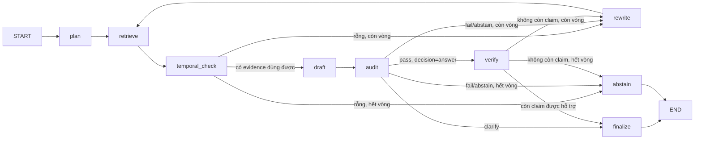

# Agent `/ask` v1 — LangGraph có kiểm soát

Hợp đồng nằm trong `src/core/agent.py`; luồng trong `src/agents/graph.py`. Tài liệu này mô tả hành vi, không sao chép schema. Search dùng nguyên hợp đồng của [search-v1](search-v1.md).

## 1. Luồng



| Node | Loại | Việc |
|---|---|---|
| `plan` | Python | Truy vấn vòng 1 = câu hỏi gốc |
| `retrieve` | Tool (SearchPort) | Hybrid search; gộp evidence qua các vòng, khử trùng theo `chunk_id`, tối đa 16 đoạn, ID ngắn `S1, S2…` ổn định |
| `temporal_check` | Python | Loại `expired`/`superseded`; gắn cảnh báo `unknown`, `as_of_date`, thiếu URL |
| `draft` | LLM | JSON `{decision, answer, claims[{text, citation_ids}], clarifying_question}` |
| `audit` | Python | Citation ID phải tồn tại trong evidence đã đưa LLM; mỗi claim ≥ 1 citation; `answer` phải có claim |
| `verify` | LLM reviewer | Chấm từng claim chỉ với đoạn nó trích; Python loại claim không được hỗ trợ và dựng lại `answer` từ các claim còn lại |
| `rewrite` | LLM | Một truy vấn thay thế, nhận feedback dạng mã lỗi (không chứa evidence) |
| `finalize` / `abstain` | Python | Ánh xạ sang `AskResponse`; số hiệu, breadcrumb, trạng thái, URL lấy từ metadata, không lấy từ chuỗi LLM |

Giới hạn vòng: `MAX_RETRIEVAL_ROUNDS` (mặc định 2). Bật/tắt reviewer: `STRICT_CITATION_VERIFICATION` (mặc định bật).

## 2. Quyết định đầu ra

| `decision` | `abstain_reason` | Khi nào |
|---|---|---|
| `answer` | — | Audit pass và còn ≥ 1 claim sau reviewer |
| `clarify` | `NEEDS_CLARIFICATION` | LLM chọn hỏi lại; trả `clarifying_question`, không có citation |
| `abstain` | `NO_EVIDENCE` | Search không trả kết quả sau mọi vòng |
| `abstain` | `ONLY_INVALID_EVIDENCE` | Mọi đoạn tìm được đều hết hiệu lực/bị thay thế |
| `abstain` | `INSUFFICIENT_EVIDENCE` | LLM đánh giá evidence không đủ ở vòng cuối |
| `abstain` | `CITATION_INVALID` | Audit vẫn fail ở vòng cuối |
| `abstain` | `UNSUPPORTED_CLAIMS` | Reviewer bác mọi claim ở vòng cuối |

`limitations` chỉ mô tả nguồn mà câu trả lời thực sự trích; với `clarify`/`abstain` chỉ giữ `EXCLUDED_INVALID_EVIDENCE`.

## 3. Lỗi

`AgentError` (`src/common/agent_errors.py`) mang mã cố định; `SearchError` được đổi sang cùng mã. `LLM_UNAVAILABLE` (thiếu key, HTTP lỗi, JSON sai schema), `LLM_TIMEOUT` (vượt `LLM_TIMEOUT_SECONDS`). Thông báo không chứa câu hỏi hay lỗi gốc của provider.

Gemini adapter (`src/agents/gemini.py`, REST qua `httpx`, không thêm dependency): retry tối đa 2 lần cho HTTP 429/500/503 theo `RetryInfo.retryDelay` hoặc `Retry-After`; không retry nếu thời gian chờ đề xuất > 60s (quota ngày đã hết).

## 4. An toàn

- Câu hỏi và evidence được đưa vào prompt dưới dạng JSON và được khai báo là dữ liệu không tin cậy.
- Log chỉ ghi `request_id`, `decision`, số vòng, trace node và thời gian — không ghi câu hỏi, evidence hay câu trả lời.
- Audit hình thức + reviewer LLM chưa chứng minh entailment; cần đánh giá claim-support trên nhãn người (roadmap §4.8).

## 5. Chạy

```bash
PYTHONIOENCODING=utf-8 uv run --locked --extra dev python scripts/ask.py --question "Thời hiệu khởi kiện tranh chấp hợp đồng là bao lâu?" --device cpu
```

Cần `GEMINI_API_KEY` trong `.env`. HTTP: `POST /ask` (xem [HTTP API v1](api-v1.md)); `Citation.chunk_id` dùng để mở nguồn qua `GET /sources/{chunk_id}`. Đánh giá đầu-cuối: `scripts/evaluate_ask.py`.

## 6. Hạn chế đã biết

- Metadata chưa có ngày hiệu lực đã xác minh: `as_of_date` chỉ sinh cảnh báo, chưa lọc được theo thời điểm.
- Chất lượng phụ thuộc retrieval: nếu đoạn có phạm vi hẹp (ví dụ một nhóm đối tượng riêng) xếp trên quy định chung, LLM và reviewer có thể vẫn khái quát hoá. Smoke test ngày 2026-11-05 ghi nhận một trường hợp như vậy.
- Gói free của Gemini giới hạn số request theo phút/ngày; mỗi câu hỏi tốn 2–5 lần gọi LLM.
