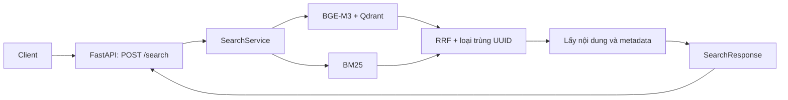

# Thiết kế và quy tắc Search API v1

- Ngày chốt: 31/10/2026.
- Trạng thái: **Đã triển khai schemas và SearchService; endpoint FastAPI do teammate tích hợp.**
- Mục tiêu: một bên phát triển retrieval, một bên phát triển FastAPI và frontend có thể tích hợp qua cùng cấu trúc dữ liệu.
- Quy tắc nền: [AGENTS.md](../../AGENTS.md). Tài liệu này cụ thể hóa phần search, không thay thế các quy tắc của dự án.

Hướng dẫn chạy và nối service: [Search integration](search-integration.md).

## 1. Phạm vi và phân công

Bản đầu định nghĩa hợp đồng `POST /search` (HTTP do teammate tích hợp), dùng Dense + BM25 + RRF, trả các đoạn luật có xếp hạng. Đây là tìm kiếm bằng chứng; kết quả chưa phải câu trả lời pháp lý đã kiểm chứng.

| Bên phụ trách | Trách nhiệm | Đầu ra bàn giao |
|---|---|---|
| Người làm search | Encoder, Dense/BM25 adapters, filters, RRF, lấy đủ nội dung chunk, đánh giá retrieval | `SearchService` trả đúng `SearchResponse` |
| Người làm FastAPI | Endpoint, request ID, validation, vòng đời service, ánh xạ lỗi HTTP, log và triển khai | `POST /search` gọi service; dùng mock trước khi retrieval hoàn tất |
| Cả hai | Review schema và interface dùng chung; quản lý cấu hình/release dữ liệu | Một bộ Pydantic v2 models, không tạo hai schema khác nhau |

Schema đặt ở `src/core/`; logic retrieval ở `src/retrieval/`; HTTP ở `src/api/`. `core` không import FastAPI, Qdrant hoặc LangChain. Route HTTP không chứa encode, BM25, RRF hay suy luận pháp lý.

LLM local/API, router, PrivacyGate, LangGraph, generation, citation audit và `/ask` là các hợp đồng bổ sung ở giai đoạn sau. Search v1 không gọi LLM sinh văn bản. Việc crawl/cập nhật corpus chạy ở ingestion, tách khỏi request tìm kiếm.



## 2. Đầu vào: SearchRequest

JSON object có đúng các trường sau; trường không được khai báo bị từ chối. Quy tắc áp dụng cả khi gọi service trực tiếp, không chỉ qua HTTP.

| Trường | Kiểu | Bắt buộc / mặc định | Quy tắc |
|---|---|---|---|
| `query` | string | Bắt buộc | Chuẩn hóa Unicode NFC, bỏ khoảng trắng hai đầu; 1–2.000 ký tự sau chuẩn hóa |
| `top_k` | integer | Mặc định `10` | Từ `1` đến `20`; không nhận chuỗi số hoặc boolean |
| `filters` | SearchFilters | Mặc định `{}` | Các điều kiện kết hợp bằng AND |

`query` không ép kiểu từ số, list hoặc object. Nếu input sau tokenization BGE-M3, tính cả special tokens, vượt giới hạn 512 token thì trả `INVALID_REQUEST`; không âm thầm cắt câu hỏi. Giới hạn query này khác với vấn đề token trong chunks nguồn đã ghi ở báo cáo migration.

### SearchFilters

| Trường | Kiểu | Quy tắc |
|---|---|---|
| `document_id` | string hoặc null | So khớp chính xác ID chuẩn; null/không truyền nghĩa là không lọc |
| `document_type` | string hoặc null | So khớp chính xác giá trị metadata, phân biệt hoa/thường; null nghĩa là không lọc |
| `issued_year` | integer hoặc null | Năm ban hành từ 1 đến 9999; không phải năm có hiệu lực |

Chuỗi filter được chuẩn hóa NFC và bỏ khoảng trắng hai đầu; chuỗi rỗng bị từ chối. Không nhận JSON filter tùy ý của Qdrant. V1 chưa hỗ trợ khoảng năm, `as_of_date`, lọc hiệu lực theo thời gian hoặc chọn model qua request.

Ví dụ request:

```json
{
  "query": "Thời hiệu khởi kiện tranh chấp hợp đồng",
  "top_k": 5,
  "filters": {}
}
```

## 3. Mỗi kết quả: SearchHit

Mọi trường dưới đây xuất hiện trong response; trường không có dữ liệu dùng null nếu kiểu cho phép. Tên ID giữ tương thích với `LegalChunk` hiện có.

| Trường | Kiểu | Ý nghĩa / quy tắc |
|---|---|---|
| `point_uuid` | UUID string | Khóa loại trùng và đối chiếu với Qdrant; giữ nguyên UUID nguồn |
| `chunk_id` | string | Định danh chunk trong corpus |
| `document_id` | string | Định danh văn bản chuẩn |
| `provision_id` | string | Định danh provision để đối chiếu benchmark |
| `article_id` | string | ID điều gốc, không tự đánh số lại |
| `document_number` | string | Số hiệu văn bản để hiển thị |
| `title` | string | Tiêu đề của điều/chunk |
| `text` | string | Nội dung nguồn, không diễn giải bằng LLM |
| `breadcrumb` | string | Đường dẫn văn bản → điều → khoản nếu có |
| `document_type` | string hoặc null | Loại văn bản theo metadata |
| `issued_year` | integer hoặc null | Năm ban hành theo metadata |
| `status` | LegalValidityStatus | Dùng enum hiện có; không xác minh được thì giữ `unknown` |
| `source_url` | string hoặc null | Chỉ điền URL nguồn đã có và được kiểm tra; không tự tạo link |
| `rank` | integer | Vị trí từ `1`, liên tiếp trong danh sách trả về |
| `score` | finite float | Điểm RRF của chunk; giữ độ chính xác khi xếp hạng |
| `matched_by` | array | Một hoặc hai giá trị `dense`, `bm25`; không lặp; thứ tự cố định dense trước |

Không trả embedding vector, `embedding_text`, credentials hoặc raw payload nội bộ. `score` không phải xác suất đúng, độ tin cậy pháp lý hay phần trăm liên quan. `status` không được suy ra từ độ mới của văn bản hoặc điểm tìm kiếm.

## 4. Đầu ra: SearchResponse

| Trường | Kiểu | Quy tắc |
|---|---|---|
| `request_id` | UUID string | API tạo UUIDv4 cho mỗi request và truyền vào service |
| `results` | array SearchHit | Tối đa `top_k`, đã sắp xếp; có thể rỗng |
| `returned_count` | integer | Chính xác bằng độ dài `results`; không phải tổng số kết quả phù hợp trong database |
| `score_method` | literal `rrf` | Cố định cho Search v1 |
| `elapsed_ms` | finite float >= 0 | Từ lúc vào service đến khi tạo xong kết quả, gồm chờ tài nguyên; không gồm truyền HTTP |
| `warnings` | array SearchWarning | Mỗi code xuất hiện tối đa một lần; rỗng nếu không có cảnh báo |

`SearchWarning` có `code` và `message` là string. V1 dùng:

- `VALIDITY_UNVERIFIED`: có kết quả với status `unknown`.
- `SOURCE_URL_UNAVAILABLE`: có kết quả thiếu URL nguồn đã kiểm chứng.

Cảnh báo nguồn/hiệu lực không khiến search thất bại. Client hiển thị cảnh báo, không gắn nhãn kết quả là văn bản đang có hiệu lực. Không có kết quả là response thành công `200`, `results: []`, `returned_count: 0`, `warnings: []`.

## 5. Interface và vòng đời

Interface bất đồng bộ thống nhất khi triển khai:

```python
async def search(
    request: SearchRequest,
    request_id: UUID,
) -> SearchResponse: ...
```

- Route tạo request ID trước validation, truyền vào service và trả cùng ID qua body và header `X-Request-ID`, kể cả response lỗi. Không lấy ID do client gửi làm request ID chính thức.
- Service nhận/trả typed models; không nhận đối tượng HTTP và không raise `HTTPException` của FastAPI.
- FastAPI ánh xạ lỗi domain sang HTTP. Dependency injection cho phép thay service thật bằng mock cùng interface.
- Khởi tạo encoder, tokenizer, BM25, chunk lookup và Qdrant client một lần ở startup; đóng tài nguyên ở shutdown. Không tải model hoặc xây index trong mỗi request.
- Trước khi nhận search, kiểm tra tài nguyên và release dữ liệu tương thích. Có thể dùng liveness `/health` và readiness `/ready`; readiness chưa đạt thì search trả `503`.
- Công việc encode/BM25 không chặn event loop; bên triển khai service giới hạn số lượt xử lý đồng thời theo tài nguyên máy.

## 6. Quy tắc retrieval và RRF

1. Một request chạy một lượt Dense và một lượt BM25 trên cùng câu hỏi đã chuẩn hóa, cùng bộ lọc. Không query rewrite, reranking hoặc retrieval loop trong v1.
2. Số ứng viên mỗi nhánh là `max(top_k, dense.top_k, sparse.top_k, fusion.top_candidates)` từ cấu hình. Đây là số ứng viên tối đa cần lấy; một nhánh có thể có ít hơn.
3. Bộ lọc áp dụng trước khi chọn top candidates trong từng nhánh. BM25 adapter phải dùng metadata đầy đủ từ chunk lookup để lọc; không chỉ lấy top-k toàn corpus rồi mới lọc.
4. Dense dùng BGE-M3/revision/normalize theo cấu hình đã khóa. Alias `vn_legal_bge_m3` được resolve lúc startup; mỗi service pin collection vật lý của release đến khi restart. BM25 dùng index, stopwords và tokenizer cùng release đã chuẩn hóa.
5. Mỗi danh sách ứng viên loại UUID trùng trước khi gán rank, giữ bản có điểm tốt nhất trong nhánh. Rank bắt đầu từ 1. Với cùng tập ứng viên và cùng điểm, tie-break theo UUID tăng dần.
6. Fusion dùng công thức sau, `rrf_k=60` mặc định từ YAML. Nhánh không có chunk đó không đóng góp điểm.

```text
rrf_score(chunk) = sum(1 / (rrf_k + rank_in_branch))
```

7. Không cộng trực tiếp điểm cosine với điểm BM25. Không làm tròn trước khi fusion/xếp hạng.
8. Sắp xếp score giảm dần; nếu bằng nhau, ưu tiên rank tốt nhất trong hai nhánh, rồi UUID tăng dần. Cắt theo `top_k` và đánh `rank` đầu ra liên tiếp.
9. Trả đủ nội dung/metadata kể cả hit chỉ xuất hiện ở BM25. Bộ dữ liệu hiện tại chưa có URL nguồn được kiểm chứng, nên source_url giữ null. Metadata BM25 hiện chưa có toàn văn, nên service phải hydrate từ canonical chunk lookup của cùng release. Payload Dense nếu không khớp canonical release được coi là lỗi dữ liệu.
10. Hai nhánh trả danh sách rỗng hợp lệ vẫn là thành công. Một nhánh lỗi/timeout thì toàn request thất bại; không âm thầm dùng một nhánh dưới nhãn Hybrid.

API chỉ trả Hybrid trong v1. Đánh giá Dense riêng/BM25 riêng dùng adapters ở tầng retrieval, không tự đổi `score_method` của `/search`.

## 7. Lỗi, timeout và bảo mật

ErrorResponse thống nhất:

```text
request_id: UUID string
code: string
message: string
```

| Tình huống | HTTP | Code |
|---|---|---|
| Sai kiểu, trường lạ, query rỗng/quá dài, top_k/filter không hợp lệ | 422 | `INVALID_REQUEST` |
| Model/index chưa sẵn sàng, sai release, thiếu payload hoặc một nhánh retrieval lỗi | 503 | `SEARCH_UNAVAILABLE` |
| Quá deadline hoặc dependency timeout | 504 | `SEARCH_TIMEOUT` |
| Lỗi ngoài dự kiến | 500 | `INTERNAL_ERROR` |

- Deadline toàn lượt service là 30 giây, bao gồm thời gian chờ tài nguyên. Timeout từng dependency không được vượt thời gian còn lại. Không tự retry cả lượt search trong v1.
- Đăng ký handler cho lỗi validation của FastAPI để trả cùng ErrorResponse; không dùng thêm một cấu trúc lỗi khác cho 422.
- Thông báo lỗi có ý nghĩa với client, không chứa key, raw exception/stack trace, đường dẫn nội bộ, payload tài liệu hoặc bản sao câu hỏi.
- API key chỉ ở backend, đọc qua settings; không nhận key/cluster URL từ body và không gửi chúng cho frontend.
- Log mặc định chỉ gồm request ID, release, thời gian, số kết quả và mã lỗi; không ghi query, lịch sử chat hoặc toàn văn hồ sơ.
- Search v1 dùng Qdrant Cloud nên có gửi vector truy vấn ra ngoài. Không coi việc chưa gọi LLM API là bảo đảm xử lý hoàn toàn local. Phải có chính sách quyền riêng tư riêng trước khi dùng hồ sơ thật nhạy cảm; client không được tự cấp quyền gửi cloud bằng một boolean.

## 8. Ba response mẫu để phát triển song song

Tất cả dữ liệu trong ví dụ có kết quả bên dưới là **fixture giả lập**, không phải căn cứ pháp lý hoặc kết quả đánh giá thực tế. UUID được sinh tất định từ chunk ID của fixture.

### Có kết quả — HTTP 200

Ví dụ một chunk xếp thứ nhất ở cả hai nhánh: score = `2 / 61`.

```json
{
  "request_id": "00000000-0000-4000-8000-000000000001",
  "results": [
    {
      "point_uuid": "3a9032eb-39b8-5e45-b869-54336018ef1b",
      "chunk_id": "law_demo_search_v1__art_1__c0",
      "document_id": "law_demo_search_v1",
      "provision_id": "law_demo_search_v1__art_1",
      "article_id": "1",
      "document_number": "DEMO/SEARCH-V1",
      "title": "Điều 1 — dữ liệu giả lập",
      "text": "Nội dung giả lập để kiểm thử hợp đồng API; không phải văn bản pháp luật.",
      "breadcrumb": "DEMO/SEARCH-V1 > Điều 1",
      "document_type": null,
      "issued_year": null,
      "status": "unknown",
      "source_url": null,
      "rank": 1,
      "score": 0.03278688524590164,
      "matched_by": ["dense", "bm25"]
    }
  ],
  "returned_count": 1,
  "score_method": "rrf",
  "elapsed_ms": 125.0,
  "warnings": [
    {"code": "VALIDITY_UNVERIFIED", "message": "Có kết quả chưa xác minh hiệu lực pháp lý."},
    {"code": "SOURCE_URL_UNAVAILABLE", "message": "Có kết quả chưa có URL nguồn được kiểm chứng."}
  ]
}
```

### Không có kết quả — HTTP 200

```json
{
  "request_id": "00000000-0000-4000-8000-000000000002",
  "results": [],
  "returned_count": 0,
  "score_method": "rrf",
  "elapsed_ms": 90.0,
  "warnings": []
}
```

### Dịch vụ chưa sẵn sàng — HTTP 503

```json
{
  "request_id": "00000000-0000-4000-8000-000000000003",
  "code": "SEARCH_UNAVAILABLE",
  "message": "Dịch vụ tìm kiếm chưa sẵn sàng. Vui lòng thử lại sau."
}
```

## 9. Điều kiện nghiệm thu và thứ tự tích hợp

- [x] Schemas/interface ở tầng core và fixtures JSON parse được theo schema; FastAPI tái sử dụng các model này.
- [x] Unit tests cho query/filter validation, UUID trùng, RRF, tie-break, rank, hydration và warning metadata.
- [x] Bộ lọc giống nhau trên Dense/BM25; top_k=20 không bị giới hạn xuống 10; có Cloud smoke test.
- [x] Test empty results, một nhánh rỗng, lỗi domain ánh xạ 503 và timeout ánh xạ 504.
- [x] Startup thiếu/sai release bị chặn; không tải model lại trong request; giữ worker có giới hạn sau timeout.
- [x] Manifest BM25 ghi checksum corpus/index/metadata/stopwords và tham số/phiên bản; startup kiểm tra local/Cloud release.
- [ ] FastAPI integration tests: gọi được mock service, HTTP body/header request ID khớp nhau; ánh xạ lỗi và log đúng hợp đồng. Teammate thực hiện khi ghép API.
- [x] Đánh giá đủ 256 câu dev với Dense/BM25/Hybrid, Recall@k/MRR và độ trễ; nhóm chunk theo provision trước khi chấm.
- [x] Giữ test cho đánh giá cuối; không điều chỉnh tham số theo test.
- [x] Ruff, format check, mypy strict và unit tests đạt. Xem số lượng/kết quả tại báo cáo Search v1.

Thứ tự: **core contracts + fixtures → FastAPI mock và retrieval làm song song → ghép /search → đánh giá retrieval → thiết kế /ask, PrivacyGate và LangGraph**.

Các thay đổi làm client phải sửa (đổi tên/kiểu trường, đổi ý nghĩa score, thay chính sách fallback) cần cả hai bên review và cập nhật tài liệu cùng fixtures trước khi triển khai. Không tự mở rộng field phía mình rồi yêu cầu bên kia đoán cách dùng.
